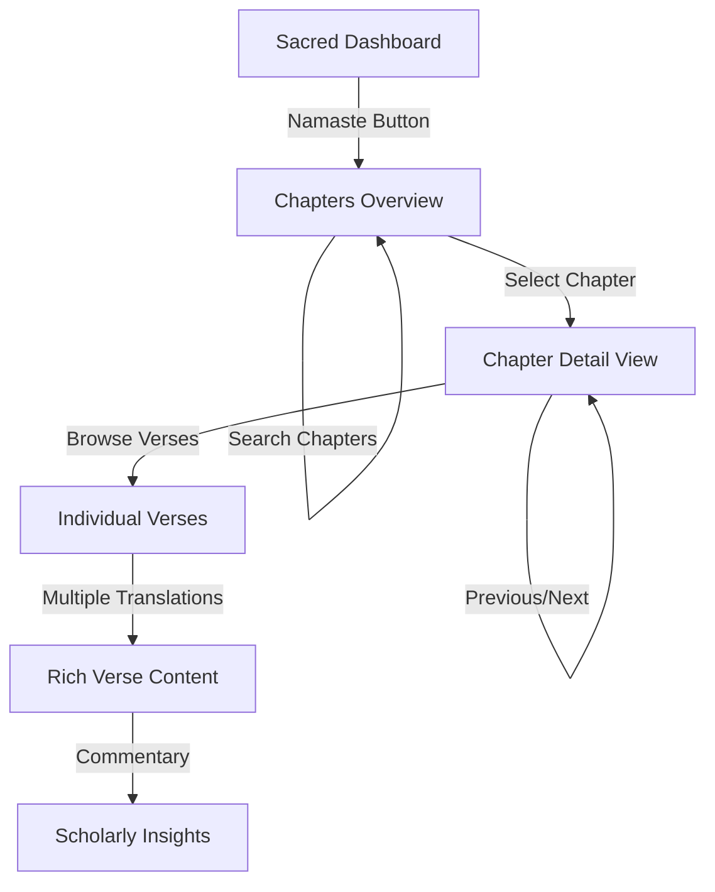

# Bhagavad Gita App 🕉️

A beautiful, immersive web application for reading and studying the Bhagavad Gita, built with modern React, TypeScript, and spiritual design principles. Experience the timeless wisdom of Krishna's teachings through an elegant, accessible digital interface.

All 18 chapters and 701 verses ship with the app as static data — Sanskrit, transliteration, word meanings, 7 translations and 16 commentaries — so pages load instantly and no API key is needed.

The redesign roadmap is in [REDESIGN_ACTION_PLAN.md](REDESIGN_ACTION_PLAN.md).

## ✨ Features

### 🏛️ **Sacred Dashboard Experience**

- **Spiritual Welcome**: Beautiful Sanskrit greeting with "Namaste" to begin your journey
- **Divine Aesthetics**: Gradient backgrounds inspired by traditional Indian art (oranges, reds, golds)  
- **Sacred Typography**: Authentic Devanagari fonts (Noto Sans Devanagari, Mangal)
- **Interactive Journey**: Feature cards showcasing app capabilities
- **Inspirational Content**: Random sacred verse quotes with translations
- **Theme Toggle**: Dark/Light mode support for comfortable reading

### � **Comprehensive Chapter Navigation**

- **All 18 Chapters**: Complete Bhagavad Gita with real API integration
- **Smart Search**: Real-time filtering across Sanskrit names, transliterations, and meanings
- **Rich Chapter Cards**:
  - Sanskrit names with proper Devanagari rendering
  - Roman transliteration for pronunciation guidance  
  - English translations and spiritual meanings
  - Verse counts and detailed chapter summaries
- **Bundled Data**: Every chapter ships with the app; nothing depends on a third-party API

### 🎯 **Immersive Chapter Experience**

- **Comprehensive Verse Display**: Every verse has its own address, e.g. `/chapter/2/verse/47`
- **Intelligent Navigation**:
  - Sticky header with chapter context
  - Scrollable sidebar with all verses for instant access
  - Previous/Next verse navigation, plus the ← and → keys
  - Moving between verses needs no network request once a chapter has loaded
- **Rich Content Presentation**:
  - **Sanskrit Verses**: Authentic Devanagari with proper line breaks
  - **Multiple English Translations**: 5 English translators; your choice is remembered across verses and visits
  - **Hindi Translations**: 2 Hindi translations on every verse
  - **Scholarly Commentaries**: 16 commentators (English, Hindi and Sanskrit), loaded only when you open them
  - **Text to Speech**: Read the Hindi or English translation, or the transliteration, aloud

### 🛡️ **Robust Technical Foundation**

- **Static, Validated Data**:
  - Built from a pinned commit of the open [gita/gita](https://github.com/gita/gita) dataset by `scripts/build-data.ts`
  - The build fails if any chapter, verse or translation is missing
  - Served with long-lived cache headers from the same origin as the app
- **Reliable Routing**:
  - Real URLs for every verse, with old `?verse=` links redirected
  - Proper "not found" pages for unknown chapters, verses and paths
  - Per-page titles, descriptions and canonical links, plus a sitemap
- **Saved Reading State**:
  - Reading history, last position and read verses persist in `localStorage`
  - Preferred translator and commentator persist across visits
  - Light/dark theme applied before the first paint on every page

### 🎨 **Modern Design Philosophy**

- **Fully Responsive**: Perfect experience on desktop, tablet, and mobile
- **Spiritual Color Palette**: Warm oranges, deep reds, and golden accents
- **Glass Morphism**: Modern UI with backdrop blur effects and transparency (`backdrop-blur-md`, `bg-white/70`)
- **Modern UI Components**: Built with Tailwind CSS and ShadCN UI
- **Accessibility First**: Proper contrast ratios, keyboard navigation, screen reader support
- **Smooth Interactions**: Elegant hover effects and micro-animations

## 🛠️ Tech Stack

### **Core Framework**

- **React 19** with **TypeScript** for type safety and modern features
- **TanStack Router** for file-based routing with dynamic parameters
- **Zustand** for lightweight, efficient state management
- **Vite** for development and lightning-fast builds

### **UI & Design System**

- **Tailwind CSS 4.0** for utility-first styling
- **ShadCN UI Components** for consistent, accessible design system
- **Lucide React** for beautiful, consistent iconography
- **Custom CSS** for Sanskrit fonts and spiritual aesthetics
- **Responsive Grid Layouts** for multi-device compatibility

### **Development & Build Tools**

- **Bun** as package manager for speed and efficiency
- **Biome** for consistent linting and code formatting
- **TypeScript** for robust type checking and developer experience
- **Vitest** for unit tests and **Playwright** for end-to-end tests on phone and desktop sizes
- **Hot Module Replacement** for instant development feedback

## 📚 Data

The text is built once from a pinned commit of the open [gita/gita](https://github.com/gita/gita) dataset (the same data the previous RapidAPI integration served) and committed to `public/data/v1/`:

```text
public/data/v1/
  chapters.json                      # 18 chapters: names, meanings, English and Hindi summaries
  chapter/{1..18}.json               # every verse: Sanskrit, transliteration, word meanings, 7 translations
  commentary/{chapter}/{verse}.json  # 16 commentators, loaded only when the reader opens commentary
public/sitemap.xml                   # home, chapter list and all 701 verse URLs
```

- `bun run data` downloads the pinned source, rebuilds these files and validates them (18 chapters, 701 verses, 7 translations per verse, every commentary file present).
- `bun run data:check` validates the committed files offline; CI runs it on every push.
- The files are served with a one-year immutable cache, so **bump `DATA_VERSION` in `src/lib/gitaData.ts` (and the folder name) whenever the data changes.**

The app reads them through `src/lib/gitaData.ts`, which caches each file in memory: once a chapter has loaded, moving between its verses makes no network request.

## 🚀 Quick Start

### **Prerequisites**

- **Bun 1.2+** (or Node.js 20+ with npm)
- **Modern web browser** (Chrome, Firefox, Safari, Edge)

No API key or environment variables are needed.

### **Installation**

1. **Clone the repository**

   ```bash
   git clone https://github.com/ankittchauhann/Bhagwat-Gita.git
   cd Bhagwat-Gita
   ```

2. **Install dependencies**

   ```bash
   bun install
   ```

3. **Start development server**

   ```bash
   bun run dev
   ```

   App will be available at `http://localhost:3000`

4. **Build for production**

   ```bash
   bun run build
   ```

## 📁 Project Architecture

```text
├── scripts/
│   ├── build-data.ts               # `bun run data` / `bun run data:check`
│   └── gita-data.ts                # Pure conversion and validation (unit-tested)
├── e2e/                            # Playwright tests (phone and desktop)
├── public/
│   ├── data/v1/                    # Generated chapter, verse and commentary files
│   └── sitemap.xml                 # Generated
├── src/
│   ├── components/
│   │   ├── ui/                     # ShadCN UI components
│   │   ├── chapter/                # Verse reader: header, selector, verse, commentary
│   │   ├── Dashboard.tsx           # Home page with a random verse
│   │   ├── ChaptersPage.tsx        # All chapters with search
│   │   ├── ChapterPage.tsx         # Verse reader page
│   │   ├── ContinueReading.tsx     # Last position and recent history
│   │   ├── RouteHead.tsx           # Per-page title, description, canonical link
│   │   ├── RouteStatus.tsx         # Loading, error and not-found pages
│   │   └── ThemeToggle.tsx         # Dark/Light theme switch
│   ├── lib/
│   │   ├── gitaData.ts             # Data types, cached loaders, URL parsing
│   │   ├── site.ts                 # Production URL and default metadata
│   │   └── theme.ts                # Theme switching (mirrors the inline script in index.html)
│   ├── store/
│   │   ├── preferencesStore.ts     # Translator, commentator, commentary open/closed
│   │   └── readingHistoryStore.ts  # Last position, history, bookmarks, read verses
│   ├── routes/
│   │   ├── __root.tsx
│   │   ├── index.tsx                              # /
│   │   ├── chapters.tsx                           # /chapters
│   │   ├── chapter.$chapterId.index.tsx           # /chapter/2 and old ?verse= links → redirect
│   │   └── chapter.$chapterId.verse.$verseNumber.tsx  # /chapter/2/verse/47
│   └── styles.css
└── vite.config.ts
```

## 🧭 User Journey Flow



## 🏗️ Data and State

Route loaders fetch data; the URL is the source of truth for which verse is shown. Zustand only holds what the reader chooses or has read.

```typescript
interface Verse {
  number: number
  speaker: string | null                 // e.g. "अर्जुन उवाच", when the source names one
  text: string                           // Sanskrit
  transliteration: string                // IAST
  wordMeanings: string
  translations: Record<string, string>   // keyed by translator id, never by position
  commentators: number[]                 // ids with a commentary for this verse
}

interface ChapterFile {
  chapter: ChapterInfo
  translators: Author[]                  // { id, name, language }
  commentators: Author[]
  verses: Verse[]
}
```

## 🎨 Design System

### **Sacred Color Palette**

```css
/* Primary Colors */
--orange-50: #fff7ed    /* Soft backgrounds */
--orange-500: #f97316   /* Primary actions */
--orange-600: #ea580c   /* Hover states */

/* Secondary Colors */  
--red-500: #ef4444      /* Accent elements */
--red-600: #dc2626      /* Active states */

/* Golden Accents */
--yellow-50: #fefce8    /* Subtle highlights */
--yellow-500: #eab308   /* Golden touches */

/* Neutral Grays */
--slate-600: #475569    /* Body text */
--slate-700: #334155    /* Headings */
```

### **Typography Hierarchy**

```css
/* Sanskrit Text */
font-family: 'Noto Sans Devanagari', 'Mangal', serif;

/* English Content */
font-family: 'Inter', -apple-system, BlinkMacSystemFont, sans-serif;

/* Size Scale */
--text-xs: 0.75rem      /* Captions */
--text-sm: 0.875rem     /* Body small */
--text-base: 1rem       /* Body text */
--text-lg: 1.125rem     /* Emphasis */
--text-xl: 1.25rem      /* Headings */
--text-2xl: 1.5rem      /* Page titles */
```

## 🔧 Available Scripts

```bash
# Development
bun run dev              # Start dev server on http://localhost:3000
bun run build            # Production build
bun run serve            # Preview production build

# Data
bun run data             # Rebuild public/data from the pinned source
bun run data:check       # Validate the committed data offline

# Code Quality
bun run lint             # Run Biome linter
bun run format           # Format with Biome
bun run check            # Lint + format combined
bun run typecheck        # TypeScript type check

# Testing
bun run test             # Unit tests (Vitest)
bun run test:e2e         # End-to-end tests (Playwright, phone and desktop)
```

Before the first `test:e2e` run, install Playwright's browser once with `bunx playwright install chromium`.

## 🌟 Production Deployment

The app is a static site: `bun run build` writes everything, including the data, to `dist/`. No server code or environment variables are involved.

1. **Vercel** (current host): connect the repository. `vercel.json` sends every non-data path to `index.html` and caches `/data/*` for a year.
2. **Any static host** (Netlify, Cloudflare Pages, GitHub Pages, nginx): serve `dist/` and rewrite unknown paths to `/index.html`, except paths under `/data/`.

The production URL used for canonical links and the sitemap is set in `src/lib/site.ts` (and in `index.html` and `public/robots.txt`); update all three if the domain changes.

## 🚧 Future Roadmap

### **Phase 1: Core Features** ✅ Completed

- [x] Rich verse display with multiple translations
- [x] Commentary integration with scholarly interpretations
- [x] Translation author selection
- [x] Static, validated data with no third-party API
- [x] Glass morphism UI with backdrop blur effects
- [x] Responsive design with spiritual aesthetics
- [x] Dark/Light theme support
- [x] Word meanings and transliteration support

### **Phase 2: Audio & Multimedia** 🔜 Next Priority

- [ ] Sanskrit pronunciation audio
- [ ] Verse-by-verse audio playback
- [ ] Audio controls and speed adjustment
- [ ] Offline audio caching

### **Phase 3: Personalization**

- [ ] Bookmark favorite verses
- [ ] Personal reading progress tracking
- [ ] Daily verse notifications
- [ ] Reading statistics and insights

### **Phase 4: Advanced Features**

- [ ] Multi-language support (Telugu, Tamil, Gujarati)
- [ ] Dark mode with spiritual themes  
- [ ] Advanced search across all verses
- [ ] Commentary comparison view
- [ ] Social sharing with beautiful verse cards

### **Phase 5: Community & Learning**

- [ ] Study guides and verse explanations
- [ ] Meditation timers with verse focus
- [ ] Community discussions and insights
- [ ] Scholar interviews and video content

## 🤝 Contributing

We welcome contributions that enhance the spiritual and technical quality of this app!

### **How to Contribute**

1. **Fork the repository**
2. **Create feature branch** (`git checkout -b feature/spiritual-enhancement`)
3. **Make changes** with proper TypeScript types
4. **Test thoroughly** across different devices
5. **Commit with meaning** (`git commit -m 'Add verse bookmarking'`)
6. **Push to branch** (`git push origin feature/spiritual-enhancement`)
7. **Create Pull Request** with detailed description

### **Development Guidelines**

- **Code Quality**: Follow TypeScript best practices
- **Accessibility**: Ensure WCAG compliance
- **Performance**: Optimize for mobile devices
- **Spirituality**: Maintain respectful, authentic content
- **Testing**: Test on multiple browsers and screen sizes

## � License

The source code is licensed under the **MIT License** - see the [LICENSE](LICENSE) file for details. The licence does not cover the Gita content; see below.

## 🙏 Acknowledgments & Credits

### **Content and credits**

- **Text data**: [gita/gita](https://github.com/gita/gita), maintained by the BhagavadGita.io team (commit `c6fce39`).
- **Sanskrit verses** are public domain. **Translations and commentaries** remain the copyright of their authors and are used under the publisher's terms ([bhagavadgita.com/copyright](https://bhagavadgita.com/copyright)): non-commercial use only, with attribution and the content kept intact. This app must therefore stay free of ads and paid features.
- **Translators**: Swami Sivananda, Swami Adidevananda, Swami Gambirananda, Dr. S. Sankaranarayan, Shri Purohit Swami (English); Swami Ramsukhdas, Swami Tejomayananda (Hindi).
- **Commentators**: Swami Sivananda (English); Swami Chinmayananda, Swami Ramsukhdas (Hindi); Sri Abhinavgupta, Sri Anandgiri, Sri Dhanpati, Sri Jayatritha, Sri Madhavacharya, Sri Madhusudan Saraswati, Sri Neelkanth, Sri Purushottamji, Sri Ramanujacharya, Sri Shankaracharya, Sri Sridhara Swami, Sri Vallabhacharya, Sri Vedantadeshikacharya Venkatanatha (Sanskrit).

### **Technical Foundation**

- **ShadCN** for beautiful, accessible UI components
- **Tailwind CSS** for expressive, maintainable styling
- **TanStack Router** for elegant routing solutions
- **Zustand** for simple, effective state management
- **Vite** for lightning-fast development experience

### **Design Inspiration**

- **Traditional Indian Art** for color palettes and aesthetics  
- **Modern Web Design** for accessibility and user experience
- **Sanskrit Typography** for authentic spiritual presentation

---

## 🕉️ About the Bhagavad Gita

The **Bhagavad Gita** ("The Divine Song") is a 700-verse Sanskrit scripture that forms part of the ancient Indian epic **Mahabharata**. It presents a profound dialogue between **Prince Arjuna** and **Lord Krishna** at the sacred battlefield of Kurukshetra.

### **Universal Teachings**

- **🏛️ Dharma** - Righteous duty and moral responsibility
- **⚡ Karma** - Action, intention, and spiritual consequences  
- **🕉️ Moksha** - Liberation and ultimate spiritual realization
- **💝 Bhakti** - Devotion, love, and surrender to the Divine

### **Timeless Relevance**

The Gita addresses fundamental human questions:

- How to live with purpose and meaning
- Balancing duty with personal desires  
- Finding peace amidst life's challenges
- Discovering our true spiritual nature

This app aims to make these profound teachings accessible to modern seekers while preserving the **spiritual authenticity** and **sacred wisdom** of the original Sanskrit text.

---

## 🌟 Final Words

> **"यदा यदा हि धर्मस्य ग्लानिर्भवति भारत।  
> अभ्युत्थानमधर्मस्य तदात्मानं सृजाम्यहम्॥"**  
>
> *"Whenever there is decline in righteousness and rise in unrighteousness, O Arjuna, at that time I manifest myself on earth."* - **Bhagavad Gita 4.7**

May this digital offering serve as a bridge between ancient wisdom and modern technology, bringing the eternal light of Krishna's teachings to seekers around the world.

**🕉️ Om Shanti Shanti Shanti 🙏**

---

<div align="center">

### **Ready to Begin Your Spiritual Journey?**

**[🚀 Launch the App](http://localhost:3000) | [📖 Read the Gita](http://localhost:3000/chapters) | [🙏 Start with Namaste](http://localhost:3000)**

*Built with � for spiritual seekers everywhere*

</div>

</div>
