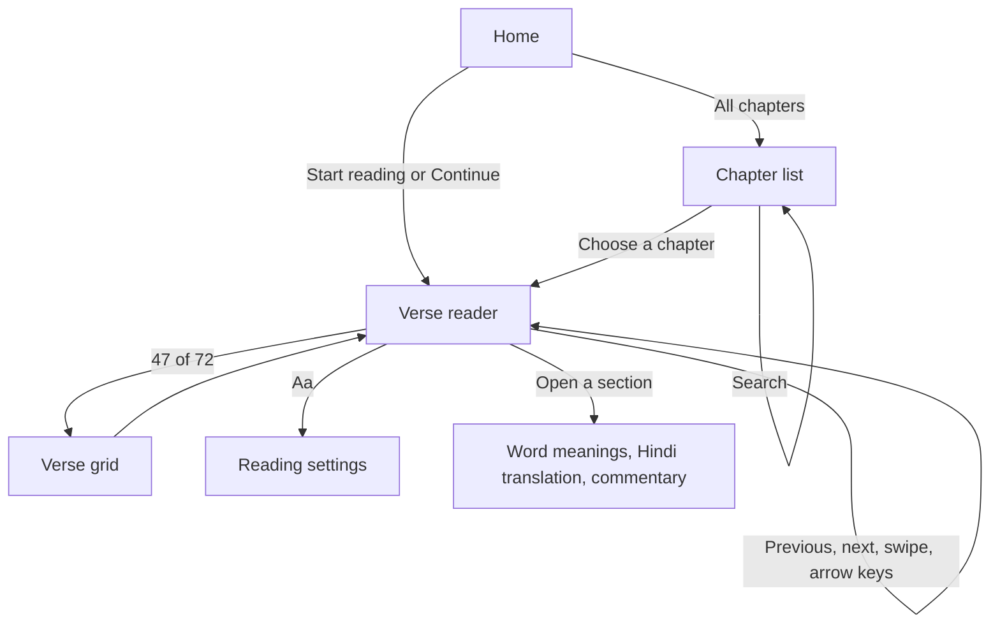

# Bhagavad Gita App 🕉️

A beautiful, immersive web application for reading and studying the Bhagavad Gita, built with modern React, TypeScript, and spiritual design principles. Experience the timeless wisdom of Krishna's teachings through an elegant, accessible digital interface.

All 18 chapters and 701 verses ship with the app as static data — Sanskrit, transliteration, word meanings, 7 translations and 16 commentaries — so pages load instantly and no API key is needed.

The redesign roadmap is in [REDESIGN_ACTION_PLAN.md](REDESIGN_ACTION_PLAN.md).

## ✨ Features

### 🏛️ **Home**

- **Start or continue**: "Start reading" on a first visit, "Continue at 2.47" afterwards, plus a list of recently read verses
- **A verse to begin with**: one of eight well-known verses, shown from the dataset with its translator named
- **Theme**: follows the system setting, or Light or Dark when chosen

### 📖 **Chapter list**

- **All 18 chapters** as compact rows: number, Sanskrit name, English name and meaning, verse count
- **Search** across Sanskrit names, transliterations and meanings
- **Bundled data**: every chapter ships with the app; nothing depends on a third-party API

### 🎯 **Verse reader** (built phone first)

- **One verse per screen**, at its own address, e.g. `/chapter/2/verse/47`
- **The verse first**: the Sanskrit set in Tiro Devanagari Sanskrit, half-verse by half-verse, closed by a red ॥ २.४७ ॥ marker as in manuscripts; the speaker ("Krishna said") on every verse
- **Moving around**:
  - A bottom bar with the previous and next verse, crossing chapter boundaries (2.72 → 3.1)
  - Swipe left or right on a phone, or use the ← and → keys
  - "47 of 72" opens a grid of the chapter's verses, with read verses marked
  - No network request once a chapter has loaded; the neighbouring chapter is fetched in advance at a chapter's edge
- **Rich content**, each section remembered open or closed:
  - **Transliteration** (IAST) under the verse
  - **Word meanings** as a term-by-term list
  - **Translations**: 5 English and 2 Hindi translators, chosen by name and remembered
  - **Commentaries**: 16 commentators (English, Hindi and Sanskrit), loaded only when you open them
- **Reading settings**: theme (System, Light, Dark), four text sizes each for the Sanskrit and the translation, show or hide transliteration, word meanings and the Hindi translation

### 🛡️ **Robust Technical Foundation**

- **Static, Validated Data**:
  - Built from a pinned commit of the open [gita/gita](https://github.com/gita/gita) dataset by `scripts/build-data.ts`
  - The build fails if any chapter, verse or translation is missing
  - Served with long-lived cache headers from the same origin as the app
- **Reliable Routing**:
  - Real URLs for every verse, with old `?verse=` links redirected
  - Proper "not found" pages for unknown chapters, verses and paths
  - Per-page titles, descriptions and canonical links, plus a sitemap
- **Saved Reading State**:
  - Reading history, last position and read verses persist in `localStorage`
  - Translators, commentator, text sizes and open sections persist across visits
  - The theme is applied before the first paint on every page

### 🎨 **Design**

- **The manuscript page as the reading surface**: black ink on paper, with red kept for the ॥ verse markers and the current verse, as a scribe would use it
- **Phone first**: designed at 390px; tablets and desktops centre the same column
- **Accessible**: WCAG 2.2 AA checked with axe in light and dark themes, full keyboard use, screen-reader announcements on verse change, `lang` on every Sanskrit, Hindi and transliterated passage, reduced motion honoured
- **Calm motion**: a 160 ms slide between verses and a 220 ms sheet, both off under reduced motion

## 🛠️ Tech Stack

### **Core Framework**

- **React 19** with **TypeScript** for type safety and modern features
- **TanStack Router** for file-based routing with dynamic parameters
- **Zustand** for lightweight, efficient state management
- **Vite** for development and lightning-fast builds

### **UI & Design System**

- **Tailwind CSS 4.0** with the colour and type tokens in `src/styles.css`
- **Own base components** in `src/components/ui/`: button, sheet (native `<dialog>`), disclosure, segmented control, switch, radio list
- **Lucide React** for icons
- **Fonts** (self-hosted with Fontsource): Tiro Devanagari Sanskrit and Hindi, Source Serif 4, Libre Franklin

### **Development & Build Tools**

- **Bun** as package manager for speed and efficiency
- **Biome** for consistent linting and code formatting
- **TypeScript** for robust type checking and developer experience
- **Vitest** for unit tests and **Playwright** for end-to-end tests on phone and desktop sizes
- **Hot Module Replacement** for instant development feedback

## 📚 Data

The text is built once from a pinned commit of the open [gita/gita](https://github.com/gita/gita) dataset (the same data the previous RapidAPI integration served) and committed to `public/data/v2/`:

```text
public/data/v2/
  chapters.json                      # 18 chapters: names, meanings, English and Hindi summaries
  chapter/{1..18}.json               # every verse: speaker, Sanskrit lines, transliteration, word meanings, 7 translations
  commentary/{chapter}/{verse}.json  # 16 commentators, loaded only when the reader opens commentary
public/sitemap.xml                   # home, chapter list and all 701 verse URLs
```

- `bun run data` downloads the pinned source, rebuilds these files and validates them (18 chapters, 701 verses, 7 translations per verse, every commentary file present, every chapter opening with a speaker line).
- Formatting only, never wording: each verse is split into its half-verse lines, the closing `।।2.47।।` becomes the red marker, the "… उवाच" speaker line is lifted out (and संजय spelled सञ्जय throughout), and the reference that opens the Hindi translations is dropped. Every verse records who speaks it: Krishna 574, Arjuna 86, Sanjaya 40, Dhritarashtra 1.
- `bun run data:check` validates the committed files offline; CI runs it on every push.
- The files are served with a one-year immutable cache, so **bump `DATA_VERSION` in `src/lib/gitaData.ts` (and the folder name) whenever the data changes.**

The app reads them through `src/lib/gitaData.ts`, which caches each file in memory: once a chapter has loaded, moving between its verses makes no network request.

## 🚀 Quick Start

### **Prerequisites**

- **Bun 1.2+** (or Node.js 20+ with npm)
- **Modern web browser** (Chrome, Firefox, Safari, Edge)

No API key or environment variables are needed.

### **Installation**

1. **Clone the repository**

   ```bash
   git clone https://github.com/ankittchauhann/Bhagwat-Gita.git
   cd Bhagwat-Gita
   ```

2. **Install dependencies**

   ```bash
   bun install
   ```

3. **Start development server**

   ```bash
   bun run dev
   ```

   App will be available at `http://localhost:3000`

4. **Build for production**

   ```bash
   bun run build
   ```

## 📁 Project Architecture

```text
├── scripts/
│   ├── build-data.ts               # `bun run data` / `bun run data:check`
│   └── gita-data.ts                # Pure conversion and validation (unit-tested)
├── e2e/                            # Playwright tests (phone and desktop), including axe accessibility checks
├── public/
│   ├── data/v2/                    # Generated chapter, verse and commentary files
│   └── sitemap.xml                 # Generated
├── src/
│   ├── components/
│   │   ├── ui/                     # Button, sheet, disclosure, segmented control, switch, radio list
│   │   ├── reader/                 # Verse reader: page, verse leaf, study sections, settings and verse-grid sheets
│   │   ├── Dashboard.tsx           # Home page
│   │   ├── ChaptersPage.tsx        # All chapters with search
│   │   ├── ContinueReading.tsx     # Recently read verses
│   │   ├── RouteHead.tsx           # Per-page title, description, canonical link
│   │   ├── RouteStatus.tsx         # Loading, error and not-found pages
│   │   └── ThemeToggle.tsx         # Dark theme button on the home page
│   ├── lib/
│   │   ├── gitaData.ts             # Data types, cached loaders, URL parsing
│   │   ├── site.ts                 # Production URL and default metadata
│   │   └── theme.ts                # System, Light or Dark (mirrors the inline script in index.html)
│   ├── store/
│   │   ├── preferencesStore.ts     # Translators, commentator, text sizes, visible and open sections
│   │   └── readingHistoryStore.ts  # Last position, history, bookmarks, read verses
│   ├── routes/
│   │   ├── __root.tsx
│   │   ├── index.tsx                              # /
│   │   ├── chapters.tsx                           # /chapters
│   │   ├── chapter.$chapterId.index.tsx           # /chapter/2 and old ?verse= links → redirect
│   │   └── chapter.$chapterId.verse.$verseNumber.tsx  # /chapter/2/verse/47
│   └── styles.css
└── vite.config.ts
```

## 🧭 User Journey Flow



## 🏗️ Data and State

Route loaders fetch data; the URL is the source of truth for which verse is shown. Zustand only holds what the reader chooses or has read.

```typescript
interface Verse {
  number: number
  speaker: "krishna" | "arjuna" | "sanjaya" | "dhritarashtra"
  speakerLine: { sanskrit: string; transliteration: string } | null  // "श्री भगवानुवाच", on a speech's first verse
  lines: string[]                        // Sanskrit half-verses (or four quarter-lines), no reference
  transliteration: string[]              // IAST lines
  wordMeanings: string
  translations: Record<string, string>   // keyed by translator id, never by position
  commentators: number[]                 // ids with a commentary for this verse
}

interface ChapterFile {
  chapter: ChapterInfo
  translators: Author[]                  // { id, name, language }
  commentators: Author[]
  verses: Verse[]
}
```

## 🎨 Design System

The tokens live in `src/styles.css`; the full rationale and measured contrast are in [REDESIGN_ACTION_PLAN.md](REDESIGN_ACTION_PLAN.md) §6.

### **Colour** (light / dark)

```css
--ground:  #eeecea / #121212   /* page */
--leaf:    #fbfaf8 / #1c1c1c   /* the verse leaf, sheets */
--surface: #e4e1dd / #262626   /* tracks, read verses, secondary buttons */
--ink:     #1f1e1d / #ecebe8   /* all running text; primary buttons */
--muted:   #5f5b57 / #a8a4a0   /* transliteration, metadata */
--rubric:  #b3261e / #ff8a7a   /* ॥ markers and the current verse only */
```

### **Type**

```css
--font-sanskrit: "Tiro Devanagari Sanskrit"   /* the verse, 24px on phones, 30px on desktop */
--font-hindi:    "Tiro Devanagari Hindi"      /* Hindi translation and commentary */
--font-serif:    "Source Serif 4 Variable"    /* English reading text; italic for IAST */
--font-sans:     "Libre Franklin Variable"    /* interface, headings, numbers */
```

## 🔧 Available Scripts

```bash
# Development
bun run dev              # Start dev server on http://localhost:3000
bun run build            # Production build
bun run serve            # Preview production build

# Data
bun run data             # Rebuild public/data from the pinned source
bun run data:check       # Validate the committed data offline

# Code Quality
bun run lint             # Run Biome linter
bun run format           # Format with Biome
bun run check            # Lint + format combined
bun run typecheck        # TypeScript type check

# Testing
bun run test             # Unit tests (Vitest)
bun run test:e2e         # End-to-end tests (Playwright, phone and desktop)
```

Before the first `test:e2e` run, install Playwright's browser once with `bunx playwright install chromium`.

## 🌟 Production Deployment

The app is a static site: `bun run build` writes everything, including the data, to `dist/`. No server code or environment variables are involved.

1. **Vercel** (current host): connect the repository. `vercel.json` sends every non-data path to `index.html` and caches `/data/*` for a year.
2. **Any static host** (Netlify, Cloudflare Pages, GitHub Pages, nginx): serve `dist/` and rewrite unknown paths to `/index.html`, except paths under `/data/`.

The production URL used for canonical links and the sitemap is set in `src/lib/site.ts` (and in `index.html` and `public/robots.txt`); update all three if the domain changes.

## 🚧 Future Roadmap

The phases, their acceptance criteria and their status are in [REDESIGN_ACTION_PLAN.md](REDESIGN_ACTION_PLAN.md) §9.

- [x] Phase 0: hygiene and guardrails
- [x] Phase 1: static data, verse URLs, bug fixes
- [x] Phase 2: design system and the mobile reader
- [ ] Phase 3: chapter list, chapter page, home, About
- [ ] Phase 4: recorded recitation and offline reading
- [ ] Phase 5: search, saved verses, progress, sharing, today's verse
- [ ] Phase 6: prerendering, SEO, launch

## 🤝 Contributing

We welcome contributions that enhance the spiritual and technical quality of this app!

### **How to Contribute**

1. **Fork the repository**
2. **Create feature branch** (`git checkout -b feature/spiritual-enhancement`)
3. **Make changes** with proper TypeScript types
4. **Test thoroughly** across different devices
5. **Commit with meaning** (`git commit -m 'Add verse bookmarking'`)
6. **Push to branch** (`git push origin feature/spiritual-enhancement`)
7. **Create Pull Request** with detailed description

### **Development Guidelines**

- **Code Quality**: Follow TypeScript best practices
- **Accessibility**: Ensure WCAG compliance
- **Performance**: Optimize for mobile devices
- **Spirituality**: Maintain respectful, authentic content
- **Testing**: Test on multiple browsers and screen sizes

## � License

The source code is licensed under the **MIT License** - see the [LICENSE](LICENSE) file for details. The licence does not cover the Gita content; see below.

## 🙏 Acknowledgments & Credits

### **Content and credits**

- **Text data**: [gita/gita](https://github.com/gita/gita), maintained by the BhagavadGita.io team (commit `c6fce39`).
- **Sanskrit verses** are public domain. **Translations and commentaries** remain the copyright of their authors and are used under the publisher's terms ([bhagavadgita.com/copyright](https://bhagavadgita.com/copyright)): non-commercial use only, with attribution and the content kept intact. This app must therefore stay free of ads and paid features.
- **Translators**: Swami Sivananda, Swami Adidevananda, Swami Gambirananda, Dr. S. Sankaranarayan, Shri Purohit Swami (English); Swami Ramsukhdas, Swami Tejomayananda (Hindi).
- **Commentators**: Swami Sivananda (English); Swami Chinmayananda, Swami Ramsukhdas (Hindi); Sri Abhinavgupta, Sri Anandgiri, Sri Dhanpati, Sri Jayatritha, Sri Madhavacharya, Sri Madhusudan Saraswati, Sri Neelkanth, Sri Purushottamji, Sri Ramanujacharya, Sri Shankaracharya, Sri Sridhara Swami, Sri Vallabhacharya, Sri Vedantadeshikacharya Venkatanatha (Sanskrit).

### **Technical Foundation**

- **Fonts** under the SIL Open Font License 1.1: Tiro Devanagari Sanskrit and Hindi (Tiro Typeworks), Source Serif 4 (Adobe), Libre Franklin (Impallari Type)
- **Tailwind CSS** for expressive, maintainable styling
- **TanStack Router** for elegant routing solutions
- **Zustand** for simple, effective state management
- **Vite** for lightning-fast development experience

### **Design Inspiration**

- **Traditional Indian Art** for color palettes and aesthetics  
- **Modern Web Design** for accessibility and user experience
- **Sanskrit Typography** for authentic spiritual presentation

---

## 🕉️ About the Bhagavad Gita

The **Bhagavad Gita** ("The Divine Song") is a 700-verse Sanskrit scripture that forms part of the ancient Indian epic **Mahabharata**. It presents a profound dialogue between **Prince Arjuna** and **Lord Krishna** at the sacred battlefield of Kurukshetra.

### **Universal Teachings**

- **🏛️ Dharma** - Righteous duty and moral responsibility
- **⚡ Karma** - Action, intention, and spiritual consequences  
- **🕉️ Moksha** - Liberation and ultimate spiritual realization
- **💝 Bhakti** - Devotion, love, and surrender to the Divine

### **Timeless Relevance**

The Gita addresses fundamental human questions:

- How to live with purpose and meaning
- Balancing duty with personal desires  
- Finding peace amidst life's challenges
- Discovering our true spiritual nature

This app aims to make these profound teachings accessible to modern seekers while preserving the **spiritual authenticity** and **sacred wisdom** of the original Sanskrit text.

---

## 🌟 Final Words

> **"यदा यदा हि धर्मस्य ग्लानिर्भवति भारत।  
> अभ्युत्थानमधर्मस्य तदात्मानं सृजाम्यहम्॥"**  
>
> *"Whenever there is decline in righteousness and rise in unrighteousness, O Arjuna, at that time I manifest myself on earth."* - **Bhagavad Gita 4.7**

May this digital offering serve as a bridge between ancient wisdom and modern technology, bringing the eternal light of Krishna's teachings to seekers around the world.

**🕉️ Om Shanti Shanti Shanti 🙏**

---

<div align="center">

### **Ready to Begin Your Spiritual Journey?**

**[🚀 Launch the App](http://localhost:3000) | [📖 Read the Gita](http://localhost:3000/chapters) | [🙏 Start at 1.1](http://localhost:3000/chapter/1/verse/1)**

*Built with � for spiritual seekers everywhere*

</div>

</div>
