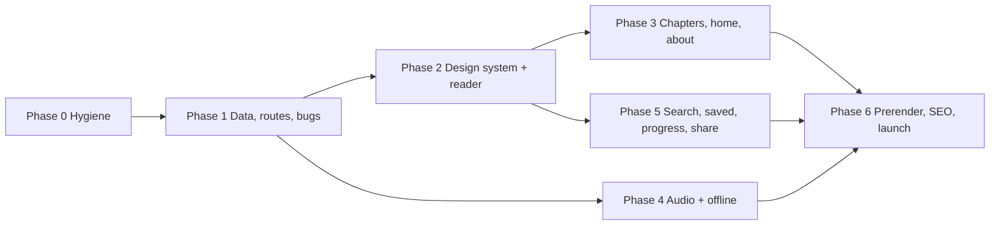

# Bhagavad Gita reader: redesign action plan

Prepared 4 November 2026 from `main` at commit `0a00d8e`. Inputs: the running app on `localhost:3000`, every file in `src/`, `api/` and the config, the dataset the app serves, and research on comparable reading apps. Every number in this document was measured or checked on that date. Anything that could not be verified is marked **Unverified**, with what would confirm it.

---

## 0. Summary

The foundation is sound. React 19, TanStack Router, Tailwind 4 and Zustand are current. `tsc --noEmit` reports 0 errors, Biome is clean, all 32 tests pass, and a reading-history store with bookmarks and streaks is already written. The problems sit in four places:

1. **Reading on a phone.** At 390px wide, the Sanskrit verse starts about one and a half screens down. It sits below a chapter summary, a voice selector and a panel of emoji badges. Every "Next" tap replaces the whole page with a spinner and drops the reader back at the top of the chapter summary.
2. **Data loading.** Each verse change makes **three** requests to a paid third-party API: the verse twice and the chapter once. Each takes 0.6–1.6 s. A static copy of the same data, from an open repository run by the same publisher, is **463 KiB gzipped for the whole Gita**. With it, navigation is instant, works offline, and costs nothing to serve.
3. **Correctness.**
   - The chosen translator is lost on every verse.
   - The default translator changes from verse to verse.
   - The three commentaries shown are the Sanskrit ones, even for English readers.
   - Dark mode is ignored on direct links.
   - An invalid chapter reports "check your internet connection".
4. **Look.** There are 77 failures against the design rules: 33 gradients, 19 resting shadows, 12 emoji, plus glass effects and violet. Body text is 14px, there is no real imagery, and nothing is specific to the Gita.

The plan has five parts:

- **(a) Data and bugs first.** Fix the data layer and the bugs, with no visual change.
- **(b) Reader.** Rebuild the reader mobile-first: one verse per screen, with previous, listen and next in a bar at the bottom where the thumb reaches.
- **(c) Design system.** Take one design system from the Gita's own manuscripts: black ink on paper, with verse numbers and ॥ marks in rubric red.
- **(d) Features.** Add recorded recitation, offline reading, search, saved verses and progress.
- **(e) Launch readiness.** Real per-verse URLs and metadata, prerendering, CI quality gates, and credits for every source.

Work is split into seven phases (0–6, §9). Each phase is releasable on its own and has measurable acceptance criteria.

---

## 1. How this plan was made

| Method | What was done | Result |
| --- | --- | --- |
| Source review | Read all components, stores, hooks, routes, API handlers, CI, `index.html`, manifest | §3 |
| Live app in Chrome | Verse navigation with network timing, theme on direct load, translator choice across verses, 404s | §3.3 |
| `design-taste-frontend` skill | `lint.mjs` on `src/`. `inspect.mjs` at 1440/768/390 on `/`, `/chapters`, `/chapter/2?verse=47`. `draw.mjs` for the page direction and the app style. `assets.mjs` search of open image collections | §3.1, §3.2, §6 |
| `web-design-guidelines` skill | Audit against Vercel's Web Interface Guidelines, fetched fresh | Appendix B |
| Dataset check | Downloaded `gita/gita` at a pinned commit; counted, validated and measured it with scripts | §3.4, §8.1 |
| Baseline | `vite build`, `vitest run` (32/32 pass), `tsc --noEmit` (0 errors), `biome check` (clean) | §3.1 |
| Web research | Gita data sources and their terms, comparable reading apps, fonts, PWA and prerender tooling | §14 |

Screenshots and inspector reports are in `.taste-skill/before/{home,chapters,reader}/`. They are local only, because `.taste-skill/` is gitignored. Appendix A has the commands to regenerate them.

---

## 2. Who it is for, and what "industry ready" means here

**Readers** (assumed, because the app has no analytics yet):

- **Daily reader on a phone.** Bilingual Hindi/English, India first. Reads or listens to a few verses, often morning or night.
- **Study reader.** Compares translations and commentaries, often on a tablet or desktop.
- **Arrival from a shared link.** Comes from WhatsApp or search and lands on **one verse**, not the home page.

**Jobs, most frequent first:**

1. Read the next verse.
2. Listen to it.
3. Jump to a reference such as 2.47.
4. Find a verse by its words.
5. Save or share a verse.
6. Continue where they left off.

**Principles:**

1. **Mobile first.** Design at 360–390px first; tablet and desktop are enlargements of it.
2. **The verse is the screen.** Everything else is one tap away and never sits in front of it.
3. **Instant and offline.** No paid runtime dependency.
4. **Free and non-commercial.** Every translator, commentator, recording and image is credited. This is a condition of the content's terms (§11).
5. **Accessible.** Meets WCAG 2.2 AA.

**Targets.** These are the acceptance gates.

| Metric | Today (measured) | Target |
| --- | --- | --- |
| Requests per verse change | 3 (620 ms, 588 ms, 1,225 ms) | 0 once the chapter file is cached |
| Next tap → new verse painted | full-page spinner, ≥ 0.6 s | < 100 ms |
| Where the verse starts at 390×844 | about 1.5 screens down | inside the first screen, below a 48px bar |
| Taste lint (`lint.mjs src`) | 77 FAIL, 32 WARN | 0 FAIL |
| Inspector at 1440/768/390 | home 9 FAIL, chapters 3, reader 5 | 0 FAIL on every route |
| Running text size | 14px | ≥ 16px; translations 17–19px |
| Reader route JS (gzip) | 84.7 kB main + 32.8 kB route chunk | ≤ 110 kB |
| Lighthouse mobile, production build | not measured | Performance ≥ 90; Accessibility, Best Practices, SEO 100 |
| axe-core violations | not measured | 0 |
| Offline | none | full text for opened or downloaded chapters; audio per chapter on request |

---

## 3. What is wrong today (evidence)

### 3.1 Measurements

| Item | Value |
| --- | --- |
| Taste lint, 30 files | **77 FAIL**: gradient 33, shadow 19, emoji 12, violet/indigo 7, hairline 5, gradient text 1. **32 WARN**: glass 13, `transition: all` 9, `100vh` 8, outlined box 1, em dash 1 |
| Inspector `/` | 9 FAIL / 8 WARN. Body text 14px; grey body text **2.6:1** contrast in dark mode; 0 images; 100% centred text; longest line about 94 characters; 3 identical icon cards; only 2 elements move |
| Inspector `/chapters` | 3 FAIL / 3 WARN. 18 heavy panel shadows; no screen title found at 390px (the only `h1` is inside the fixed header); 0% tabular figures |
| Inspector reader (`/chapter/2?verse=47`) | 5 FAIL / 2 WARN. 9 gradient fills; emoji; no screen title at 390px; side-by-side cards differ in height by 460px |
| API latency (dev proxy → RapidAPI) | chapters 1.01 s, chapter 0.64 s, verse 1.45–1.61 s |
| One verse response | 64,316 bytes uncompressed, including 15 commentaries |
| Production build | JS 137 kB gzip in total (main 264.7 kB / **84.7 kB** gzip; reader chunk 99.4 kB / **32.8 kB** gzip). CSS 71.9 kB / 12.1 kB gzip. Fonts: Noto Sans Devanagari, 160 kB in 3 subsets (Devanagari subset 121 kB) |
| Quality | Vitest 32/32 pass in 4 files; `tsc --noEmit` 0 errors; Biome clean |

### 3.2 Critique of the current build

This uses the skill's critique format, judged from the `.taste-skill/before` screenshots.

```text
ROUND 0 (current build)
Seen in one second: a saffron-to-red gradient, a gradient Devanagari title, an emoji "Namaste" button, three icon cards.
Idea (one sentence): none beyond "spiritual means saffron gradient"; it would fit any devotional app.
Live thing: a random quote on the home page; it cannot be played, saved or shared.
Layout words by section: hero=centred title + button / features=three icon cards / quote=gradient card /
  footer=centred credit line; reader=verse list + summary card + verse card stack.
Scores: design 4 · usability 4 · creativity 3 · content 6 → overall 4.0
Caps applied: inspector FAILs (≤ 6.0); gradients, resting shadows, hairlines (≤ 6.5);
  fewer than four real pictures (design ≤ 6.5); could belong to anyone (creativity ≤ 6).
Top three problems:
1. Reader at 390 (reader/mobile-page-01.jpg): the verse starts about 1.5 screens down, under the
   whole chapter summary, a voice selector and a badge panel; prev/next sit after the commentaries,
   another screen further. Fix: the verse first, the summary on its own chapter page, a fixed bottom bar.
2. Home at 1440 and 390 (home/desktop-page-01.jpg, home/mobile-page-01.jpg): a gradient-clipped h1,
   an emoji button whose label is a greeting rather than an action, three icon cards, and 14px grey
   body text at 2.6:1 in dark mode. Fix: the page-is-the-object home in §6.6 D.
3. Chapters at 390 (chapters/mobile-fold.jpg): each chapter is a card about 365px tall, so only about
   two chapters fit per screen. Fix: list rows of about 84px, seven or more chapters per screen.
```

### 3.3 Functional bugs, each verified

| # | Bug | Evidence | Cause |
| --- | --- | --- | --- |
| B1 | **3 requests per verse change** | Resource timing after one Next tap on 2.47: `/api/chapters/2/verses/48` 620 ms, `/api/chapters/2` 588 ms, `/api/chapters/2/verses/48` again 1,225 ms | `ChapterPage.tsx:45` fetches the verse. The effect at `ChapterPage.tsx:91-94` then refetches both chapter and verse, because `selectedVerse` is one of its dependencies |
| B2 | **The whole page becomes a spinner on every verse change, then lands at the top** | "Loading chapter..." rendered after Next; `scrollY` was 0 afterwards | One shared `loading` flag (`gitaStore.ts:109,128,147,166`); `ChapterPage.tsx:129-144` returns the spinner instead of the page |
| B3 | **Translator choice is lost, and the default changes per verse** | Chose Swami Sivananda on 2.47 → 2.48 showed Shri Purohit Swami. The API's English order on 2.47 starts with Gambirananda; on 2.48 it starts with Purohit Swami | The choice is an array index (`VerseDisplay.tsx:30`) that resets when B2 remounts the component, and the array order differs per verse |
| B4 | **Only Sanskrit commentaries are shown** | For 2.47 the first three of 15 are Abhinavgupta, Anandgiri and Dhanpati. Swami Sivananda (English), Swami Chinmayananda and Swami Ramsukhdas (Hindi) never appear | `VerseDisplay.tsx:300` takes `slice(0, 3)` |
| B5 | **Saved dark theme ignored on direct links** | With `localStorage.theme = "dark"`, loading `/chapters` directly leaves `<html>` without `.dark` | The theme is applied only inside `ThemeToggle`'s effect, and `ThemeToggle` renders only on the home page (and in the unused `Header.tsx`) |
| B6 | **Dark mode incomplete where it does apply** | The chapters header stays white (`ChaptersPage.tsx:103`, `ChapterHeader.tsx:13`, both `bg-white/80` with no dark variant). Home card text measures 2.6:1 | Missing `dark:` variants; fails WCAG 1.4.3 |
| B7 | **An invalid chapter reports a network fault** | `/chapter/99` shows "Connection Issue… Check your internet connection" | Every failure goes through one error screen (`ChapterPage.tsx:146-181`) |
| B8 | **Unknown URLs show a bare "Not Found"** | `/this-page-does-not-exist` renders TanStack's default text | No `notFoundComponent` |
| B9 | **No keyboard navigation**, although the README promises it | No `keydown`/`onKeyDown` anywhere in `src/` | Not built |
| B10 | **The theme switch announces the wrong state and has no visible focus** | `checked` means light while the label says "Toggle dark mode" (`ThemeToggle.tsx:32-34`). The input has opacity 0 and `.slider` has no `:focus-visible` style | `styles.css:42-61` |
| B11 | **Text-to-speech problems** | `alert()` (`useTextToSpeech.ts:47`). The "Sanskrit" option reads the Roman transliteration with a Hindi voice (`VerseDisplay.tsx:74-78`) | Web Speech workaround |
| B12 | **An empty section shows an apology** | "Word meanings not available…" paragraph (`VerseDisplay.tsx:230-233`) | Should hide the section instead |
| B13 | **Opening a verse directly wipes saved reading history** (found during Phase 1) | Seeded 3 history entries and 3 read verses, then opened `/chapter/2?verse=47` directly: both were reduced to the single verse 2.47 | The store started empty and loaded `localStorage` only on the home page, so the verse page saved over the stored data |
| B14 | **A quick second step while the next chapter loads skips a verse** (found during Phase 2) | With chapter 2's file delayed by 1.5 s: on 1.47, → then ← landed on 1.46 instead of returning to 1.47 | The URL changes at once, but the old verse stays on screen until the new chapter arrives, and the second step was counted from it |
| B15 | **Every page downloads a 1.2 MB favicon, and the iOS home-screen icon is the React logo** (found during Phase 2) | Lighthouse: `/Bhagwat-Gita.png` 1,224 KB on the reader's first load; `logo192.png`, `logo512.png` and `favicon.ico` are the Create React App images | `index.html` pointed the icon at the 1024px artwork and the apple-touch-icon at the template file |

Checked and fine: the router devtools render only in development, and `readingHistoryStore` serialises its `Set` correctly.

### 3.4 Data and content issues, checked against the dataset

| Issue | Detail | Handling |
| --- | --- | --- |
| Verse count | The data has **701** verses; chapter 13 has 35 because 13.1 is Arjuna's question, which some editions omit. The home page says "700 Verses" | Use 701 everywhere and explain it on About |
| Speaker lines | **Corrected in Phase 2:** Krishna's lines are present, as "श्री भगवानुवाच" in 28 verses; the Phase 0 check searched for "उवाच" and missed the sandhi form. Every change of speaker is marked, 60 in all, and every chapter opens with one | Lift the line out at build time and carry the speaker forward (§8.1) |
| Speaker lines run into verses | No line break in **12.1, 12.2, 13.2, 14.1, 14.21, 14.22, 15.1, 17.1, 17.2, 18.73 and 18.74** | Split at build time |
| Half-verses on one line | From 12.1 on, **222 verses** separate their half-verses with a single danda and no line break | Split at the single danda at build time |
| Mixed-speaker verses | 1.21 and 1.28 open with Sanjaya's narration, but the source puts Arjuna's speaker line first; the translations also open with "Arjuna said" | Follow the source: both count as Arjuna's. Hence Arjuna 86 and Sanjaya 40, against the traditional 84 (85 with 13.1) and 41 |
| Other source quirks | 11.19's transliteration is in Devanagari; 4 verses' word meanings are not in "term—meaning" form; some transliterations contain runs of spaces | Tag 11.19 `lang="sa"`; show those 4 word meanings as plain text; collapse the spaces |
| Inconsistent spelling | "Sanjaya" is spelled सञ्जय 8 times and संजय once | Normalise at build time |
| Inline verse references | The text ends with `।।2.47।।`, written as two single dandas (U+0964) instead of ॥ (U+0965). Half-verses are separated by a blank line, which renders a gap mid-verse | Render the marker separately and drop the blank line. This is display only (§11) |
| Unused content | Hindi chapter summaries (`chapter_summary_hindi`) are in the dataset but not shown | Show them on the chapter page |
| Commentary volume | 11,186 records from **16 commentators**: 1 English, 2 Hindi, 13 Sanskrit. Vedantadeshikacharya Venkatanatha covers 671 verses, the rest all 701. 28.2 MB raw; per verse 7.1 KiB gzip median, 62.2 KiB maximum | Load per verse only when opened |
| Translations | 4,907 records: **7 translators × 701**. English: Adidevananda, Gambirananda, Sivananda, Sankaranarayan, Purohit Swami. Hindi: Ramsukhdas, Tejomayananda | Key by translator ID, never by array position |

### 3.5 Platform, security and repository

- **The proxy is open to anyone.** `api/_lib/utils.js:2-3` sends `Access-Control-Allow-Origin: *` together with `Allow-Credentials: true`. That combination is invalid for credentialed requests, and the wildcard lets any website spend this app's RapidAPI quota from its visitors' browsers. `/api/*` can also be called directly by any server.
- **Nothing is cached.** API responses set no `Cache-Control` (`api/_handlers/*.js:32`), so every view is a paid upstream call.
- **Inputs aren't validated.** `chapterId` and `verseNumber` go from `req.query` (`verse.js:17`) straight into the upstream URL (`verse.js:20`).
- **Repository hygiene:**
  - No `LICENSE` file, although the README claims MIT.
  - README line 3 is garbled: two paragraphs spliced together.
  - The README still documents `VITE_RAPIDAPI_KEY`, which is no longer used.
  - Two router-generator scratch files are committed at the root (`91ba248d-…`, `ddca303e-…`, from commit `2ef8311`).
  - `src/components/Header.tsx` is never imported.
  - `.gitignore` lists `count.txt`, a leftover from the template.
- **CI gaps.**
  - `bun-version: latest` is not reproducible; local Bun is 1.2.23.
  - CI never type-checks, because `vite build` strips types without checking them.
  - There are no end-to-end, accessibility or performance checks.
- **Unused metrics.** `reportWebVitals()` at `main.tsx:53` has no handler, so it does nothing.
- **Sharing metadata:**
  - `og:image` and `twitter:image` use relative URLs (`index.html:22,30`); link-preview crawlers need absolute ones.
  - Every route has the same `<title>`.
  - The manifest uses theme colour `#000000` and lists 16–64px icons.
  - The manifest has no maskable icon.

The full Web Interface Guidelines audit is in **Appendix B**.

---

## 4. Keep, remove, add

### 4.1 Keep

- The stack: React 19, Vite 6, TanStack Router with file routes and automatic code splitting, Tailwind 4, Zustand 5, Biome, Vitest and Bun. No framework migration; Phase 6 weighs TanStack Start, which uses the same router.
- `readingHistoryStore` and its existing `localStorage` keys: `gita_last_position`, `gita_reading_history`, `gita_bookmarks`, `gita_reading_stats`. Existing readers' history must survive.
- Self-hosted fonts through Fontsource, with a preload (`main.tsx` already does this).
- `defaultPreload: "intent"` (`main.tsx:26`).
- All content: 7 translations, word meanings, transliteration, 16 commentaries.
- Old links such as `/chapter/2?verse=47`, which keep working through redirects.

### 4.2 Remove

| What | Where | Why | Replaced by |
| --- | --- | --- | --- |
| RapidAPI and the serverless proxy | `api/`, `devProxy.ts`, `devProxy.test.ts`, the `server.proxy` block in `vite.config.ts`, `@vercel/node`, `RAPIDAPI_*` variables | Cost, latency, an open proxy, 3 calls per verse | Static JSON built from the open dataset (§8.1). **Revoke the RapidAPI key after deploying** |
| Full-page loading and error screens | `ChapterPage.tsx`, `ChaptersPage.tsx` | They hide the page and reset state | Route skeletons drawn at real size; errors shown in place |
| Chapter summary above every verse | `ChapterSummaryCard` inside the reader | Pushes the verse 1.5 screens down | The chapter page |
| Emoji badge panel ("Sanskrit, Transliteration, …") | `VerseDisplay.tsx:158-189` | Decoration and emoji | Nothing; each section has its own heading |
| Feature icon cards ("18 Chapters / 700 Verses / Timeless Wisdom") | `Dashboard.tsx:148-204` | A stock layout with a wrong count | A row of real figures (§6.6 D) |
| "🙏 Namaste" button | `Dashboard.tsx:129-135` | A greeting, not an action | "Start reading" or "Continue at 2.47" |
| Gradients, glass, resting shadows, emoji, flags for languages, violet, gradient text | Throughout (lint list) | Design rules and contrast | Tokens in §6.2 |
| Animated sun/moon switch | `ThemeToggle.tsx`, `styles.css` (`.switch`, `.slider`, `.star`, `.cloud`) | Inverted state and no visible focus | A System/Light/Dark setting plus a plain toggle |
| Browser text-to-speech (`speak-tts`) | `useTextToSpeech.ts`, `VerseDisplay.tsx` | A Hindi voice reading Roman text; `alert()` | Recorded recitation (§8.7) |
| Mobile verse `<Select>` with up to 78 options | `VerseSelector.tsx` | Slow to scan by thumb | A verse-grid sheet |
| Chapter search field | `ChaptersPage.tsx` | It filters only 18 names | Global search (Phase 5) |
| Footer "Made with ❤️, devotion and AI" | `Dashboard.tsx:227-245` | Not the credits the content requires | A credits imprint |
| Dead files | `Header.tsx`, the two root scratch files, the `count.txt` entry in `.gitignore` | Unused | Nothing |

### 4.3 Add

P0 means launch-blocking, P1 means part of launch, and P2 means after launch.

| Priority | Feature | Why | Phase |
| --- | --- | --- | --- |
| P0 | Static, validated data with a pinned source | Fixes B1–B4; offline; no cost | 1 |
| P0 | Path URLs per verse, redirects, real 404s | Shareable links; fixes B7–B8 | 1 |
| P0 | Theme applied before first paint on every route; complete dark tokens | Fixes B5–B6 | 1–2 |
| P0 | Mobile reader: verse first, bottom bar, swipe, keyboard | Main job | 2 |
| P0 | Reading settings: translator by name, show/hide sections, text size, theme | Personal reading; fixes B3 for good | 2 |
| P0 | Per-route title, description, canonical URL, absolute OG image; sitemap | Search and sharing | 1 |
| P0 | Sources & credits page; `LICENSE` | Content terms (§11) | 0, 3 |
| P1 | Chapter page with summary (English and Hindi), progress and verse grid | Orientation | 3 |
| P1 | Recorded recitation: continuous play, speed, repeat, lock-screen controls | Listening is the second job. **Blocked on D-2** | 4 |
| P1 | Offline and installable (PWA) | Daily use on poor networks | 4 |
| P1 | Search: reference jump plus full text | "Find a verse" job | 5 |
| P1 | Saved verses with notes; progress and streak (the store already exists) | Retention | 5 |
| P1 | Share a verse (Web Share API, copy with citation) | Arrivals from shared links | 5 |
| P1 | Today's verse (the same for everyone on a given date) | The page's one live thing | 5 |
| P1 | Prerendered HTML for every public URL | Link previews and SEO without JavaScript | 6 |
| P2 | Two commentaries side by side (tablet and desktop) | Study reader | later |
| P2 | Hindi interface | India-first audience (D-7) | later |
| P2 | Memorisation mode: repeat a verse N times, hide the translation | Chanting practice | later |
| P2 | Generated share image per verse | Richer previews | later |

---

## 5. The idea

> **In this app, the Gita's own manuscript and printed page becomes the reading surface.** That means black ink on paper, with each verse closed by a ॥ number mark in red and the speaker named before each speech. One verse fills one leaf. Red is used only for what a scribe would have inked in red.

- **Where it comes from.** Two checked sources show it. A Devanagari manuscript page of 4.7–4.10 has black text, red ॥ marks around the verse numbers, and red-ruled margins. A 19th-century Bengali printed Gita sets a centred heading before each speaker's verses, such as "Dhṛtarāṣṭra said", "Śrī Bhagavān said" or "Arjuna said". Both images are in §6.5.
- **Why it isn't generic.** Saffron gradients, Om symbols and lotus motifs would fit any devotional app. This look comes from how this particular text has been written and printed.
- **The live thing:** **today's verse**. Everyone sees the same verse on a given date, so it can be shared. It appears on the home page's leaf with "Listen" (the recorded recitation) and "Save". Before JavaScript loads, the prerendered page shows a fixed verse.

---

## 6. Design system

### 6.1 Directions dealt by the taste skill

- **Home page**: direction `page-is-the-object` (seed 1126443065).
  - Hero: "Striped card beside the room".
  - Type: Libre Franklin and Source Serif 4.
  - Palette: "Three stones".
  - Sections: intro → list → showcase → about → footer.
  - Motion: "Slow crossfade".
  - Redraws: none.
  - Two adjustments, both allowed by the skill's rules:
    - The accent becomes the manuscript's rubric red; the subject has a colour of its own, and the dealt proportions are kept.
    - Devanagari faces are added, because the dealt faces contain no Devanagari.
- **App screens** (chapters, chapter, reader, settings, search, saved): style `achromatic-ledger` (seed 589920463), kind `workspace`, shell "No sidebar", with the page's palette and type kept.
  - Why this style: the app is one person reading for a long time.
  - Its defining rule: no colour anywhere in the interface chrome, and one hue reserved for the main mark. That is the manuscript convention.
- The sheets are saved at `.taste-skill/direction.json` and `.taste-skill/app/direction.json`. Reprint them with `node .claude/skills/design-taste-frontend/scripts/draw.mjs --show` (needs Node 22 or newer).

### 6.2 Colour tokens

Contrast was measured with the WCAG 2.x formula.

| Role | Light | Dark | Use |
| --- | --- | --- | --- |
| `--ground` | `#eeecea` | `#121212` | Page |
| `--leaf` | `#fbfaf8` | `#1c1c1c` | The verse leaf, sheets, the paper object on the home page |
| `--surface` | `#e4e1dd` | `#262626` | Panels, read cells, secondary controls |
| `--field` | `#cdc3b6` | `#33302c` | One band per page at most |
| `--ink` | `#1f1e1d` | `#ecebe8` | All running text; primary button fill (light) |
| `--muted` | `#5f5b57` | `#a8a4a0` | Transliteration, metadata |
| `--rubric` | `#b3261e` | `#ff8a7a` | Verse-number marker, current verse, audio progress. **Marks only** |

Measured contrast, on light / on dark:

| Text | on ground | on leaf | on surface | on field |
| --- | --- | --- | --- | --- |
| ink | 14.13 / 15.71 | 15.96 / 14.30 | 12.77 / 12.69 | 9.57 / 11.01 |
| muted | 5.71 / 7.57 | 6.45 / 6.88 | 5.16 / 6.11 | **3.87** / 5.30 |
| rubric | 5.55 / 8.18 | 6.27 / 7.44 | 5.02 / 6.61 | **3.76** / 5.73 |

Rules that follow from the measurements:

1. **Text on the light `--field` band is ink only.** Muted and rubric text fail there (3.87 and 3.76).
2. **Never put white text on red.** White on the dark-mode red is 2.29:1.
3. **Primary buttons are ink-filled.** In light mode: `--ink` fill with `--leaf` text (15.96:1). In dark mode: `--ink` fill with `--ground` text (15.71:1).
4. **Errors are ink text with one small red icon,** never paragraphs of red text.
5. **Red covers under 1% of any screen** (achromatic-ledger budget).
6. **The light ground passes the "not cream" check:** `#eeecea` has saturation 0.12, under the 0.15 limit.

### 6.3 Type

| Role | Face | Package (verified on npm) | Phone → desktop | Leading |
| --- | --- | --- | --- | --- |
| Sanskrit verse | Tiro Devanagari Sanskrit 400 | `@fontsource/tiro-devanagari-sanskrit` 5.3.0 | 24 → 30px | 1.8 |
| Hindi translation and commentary | Tiro Devanagari Sanskrit 400 (the Hindi cut was dropped in the laptop-layout follow-up: the inspector counted it as a fourth face and it cost 99 kB; Gita Press sets its Hindi in the same traditional style) | as above | 18 → 21px | 1.75 |
| English reading text (italic for transliteration) | Source Serif 4 (variable) | `@fontsource-variable/source-serif-4` 5.3.1 | 17 → 19px | 1.55 |
| Headings, interface, numbers | Libre Franklin (variable) 600/700 | `@fontsource-variable/libre-franklin` 5.3.0 | Interface 15–16px; screen titles 20–24px | 1.2 |
| Home h1 | Libre Franklin 700, tracking −0.035em | as above | `8vw` (≈ 31px at 390) → `3.6vw` (max 56px) | 0.92–1.05 |

- **Typeface count.** Latin text uses the two dealt faces. Tiro Devanagari is added because neither dealt face contains Devanagari; it is one design family (Tiro Indic, SIL OFL 1.1) in its Sanskrit and Hindi cuts. Tiro replaces Noto Sans Devanagari.
- **Size limits.** At most five sizes per screen; nothing below 13px; tabular figures for verse counts and progress.
- **No faux italic on Devanagari.** `Dashboard.tsx:211` currently slants Sanskrit text.
- **Language tags:** `lang="sa"` on Sanskrit, `lang="hi"` on Hindi, and `lang="sa-Latn"` on IAST transliteration. Screen readers need them, and they make font fallback correct.
- **Font budget.** Preload only the Devanagari subset needed above the fold, as `main.tsx` does now, with `font-display: swap`. Budget: ≤ 200 kB of fonts on the reader's first load. This is a target: measure the Tiro subsets in Phase 2.

### 6.4 Space, shape, motion

- **Margins:** 16px on phones, 24px on tablets. On desktop the app uses a centred 1088–1208px column, with the verse leaf at 680–720px. Translations are held to 60–68 characters per line.
- **Corners:** app screens use 8px panels and 6px controls (achromatic-ledger). The home page's paper objects have square corners and shaped edges (scalloped or notched), per the direction.
- **Touch targets:** ≥ 44×44px. WCAG 2.5.8 requires 24px; 44px matches platform guidance.
- **Elevation:** tone steps only. Shadows go only on what floats: sheets, menus, dialogs.
- **Motion:** `transform` and `opacity` only.
  - Verse change: a 160 ms crossfade with a 12px slide in the direction of travel.
  - Sheets: 220 ms.
  - Home photograph: crossfades over 1.6 s, holds 5–6 s, and pauses while the tab is hidden.
  - With `prefers-reduced-motion`, nothing travels and swaps are instant.

### 6.5 Imagery (home and About only; the reader stays text-only)

Found with `assets.mjs` on 4 Nov 2026. All are on Wikimedia Commons under **CC BY-SA 4.0**. Credit is required, and an altered version, such as a crop or recolour, must be shared under the same licence.

| # | Image | Creator | Source | Use | Viewed |
| --- | --- | --- | --- | --- | --- |
| 1 | "4th Chapter, verses 7-10, Bhagavad Gita, Sanskrit, Devanagari script" | Ms Sarah Welch | <https://commons.wikimedia.org/w/index.php?curid=73576366> | Hero crossfade, first frame; shows the red marking | yes |
| 2 | "1st and 2nd chapter face page, Bhagavad Gita, Bengali script, 19th century" | Ms Sarah Welch | <https://commons.wikimedia.org/w/index.php?curid=73586243> | Crossfade; shows the speaker headings | yes |
| 3 | "3rd Chapter Verses 1-2, Bhagavad Gita, Gurmukhi script, Punjab" | Ms Sarah Welch | <https://commons.wikimedia.org/w/index.php?curid=73586244> | Crossfade | **not yet; look before use** |
| 4 | "18th century Bhagavad Gita and bhasya, Sanskrit, Kannada script, Karnataka" | Ms Sarah Welch | <https://commons.wikimedia.org/w/index.php?curid=73576370> | Crossfade | **not yet; look before use** |
| 5 | "Kurukshetra Angkor Wat 0859" (bas-relief of the battle) | Michael Gunther | <https://commons.wikimedia.org/w/index.php?curid=34714279> | Showcase or About plate | yes |

The crossfade shows one text in four scripts. Download the images with `assets.mjs --get <ref>` so each source and licence is recorded, then print the footer credit line with `--credits`. Captions say what each image is; none is presented as the app's own.

### 6.6 Screens, phone first

#### A. Verse reader: `/chapter/:c/verse/:v`

**Question it answers:** "What does this verse say?" The Sanskrit verse is the largest thing on screen.

```text
390 x 844
+--------------------------------------+
| <  Chapter 2 · Sankhya Yoga      Aa  |  48px bar, sticky; rule only once content scrolls under it
|--------------------------------------|
| 2.47                       47 of 72  |  h1 20px + position (tabular)
| Sri Bhagavan said                    |  speaker line, muted 15px
|                                      |
| [Sanskrit half-verse 1]              |  Tiro Sanskrit 24px / 1.8
| [Sanskrit half-verse 2]   (|| 2.47 ||)  rubric marker
|                                      |
| [IAST transliteration, italic]       |  17px muted, toggle in settings
|                                      |
| [Selected translation, 18px ink]     |
| - Swami Sivananda          Change    |  translator by name
|                                      |
| Save   Share   Copy                  |  text actions, 44px tall
|--------------------------------------|
| > Word meanings                      |  disclosures, 48px rows
| > Hindi translation (2)              |
| > Commentary · Swami Sivananda       |  picker grouped English / Hindi / Sanskrit
|--------------------------------------|
|  < 2.46    [>] Listen 0:24    2.48 > |  56px bar + env(safe-area-inset-bottom)
+--------------------------------------+
```

- **Bottom bar.**
  - Previous and next are links that show the target reference.
  - At the end of a chapter, "next" reads "3.1" and goes there.
  - Tapping "47 of 72" opens the verse-grid sheet.
  - "Listen" is hidden until audio ships (D-2).
- **Changing verse.**
  - The new verse renders from the cached chapter file with no network request.
  - The page scrolls to the top of the leaf.
  - Focus moves to the `h1`, and a polite live region announces "Chapter 2, verse 48".
- **Input.**
  - A horizontal swipe changes verse (touch only, with a threshold, and not while text is selected). The buttons and the ← → keys do the same thing.
  - Esc closes sheets.
- **Remembered settings.** Section open/closed state, the translator and the commentator are remembered across verses and visits. The translator and commentator are keyed by author ID (fixes B3).
- **Commentary default.** English first when available; a choice from English (1), Hindi (2) and Sanskrit (13) (fixes B4).
- **States.**
  - Skeleton at real size only while the chapter file is uncached.
  - Errors in place, with Retry.
  - A verse number past the chapter's count shows the 404 page, with a link to the chapter.
- **Larger screens (revised after Phase 2, see "Phase 2 follow-up").** Tablet (768–1023px) keeps one column with a larger type step. Laptop and desktop (≥ 1024px) use the full 1208px column: a chapter ruler with previous and next under the top bar; a wide pothi leaf with red-ruled margins and the verse centred at up to 40px; English and Hindi side by side; then commentary and word meanings in the same two columns.

#### B. Chapter page: `/chapter/:c`

**Question it answers:** "What is this chapter, and where do I start?"

```text
+--------------------------------------+
| <  Chapters                Search  = |
|--------------------------------------|
| Chapter 2                            |  h1 24px
| [Devanagari name]  Sankhya Yoga      |
| Transcendental Knowledge             |
| [ Continue at 2.48 ]                 |  primary, ink fill, full width
| 12 of 72 read  [=====-----------]    |  bar at the true ratio
| [Summary, 4 lines]  Read more        |  English | Hindi
| Verses                               |
| [1][2][3][4][5][6][7]                |  44px cells, 7 per row = 7x44 + 6x6 = 344px
| [8][9]...                            |  read = surface tint; current = 2px rubric ring
+--------------------------------------+
```

#### C. Chapter list: `/chapters`

**Question it answers:** "Which chapter do I open, and where did I stop?"

- Rows about 84px tall, each a single link. A row shows the chapter number (tabular), the Devanagari name (Tiro, 18px), the English meaning (15px, muted), and on the right the verse count and progress ("12 / 72").
- A "Continue at 2.48" row is pinned first when there is reading history.
- Optional group headings for the traditional three groups of six chapters (D-3).

#### D. Home: `/`, from the page-is-the-object sheet

In phone order:

1. **Photograph.** The manuscript crossfade, full width inside 12px margins, 48svh tall.
2. **The leaf card.** It overlaps the photograph by 24px.
   - A band of alternating rubric and paper blocks.
   - The wordmark श्रीमद्भगवद्गीता.
   - **h1: "The Bhagavad Gita, verse by verse"**. That is 33 characters, about two lines at 8vw on a 358px measure and at 3.6vw on the desktop card; confirm with `inspect.mjs`.
   - One sentence: "All 18 chapters and 701 verses in Sanskrit, with transliteration, word meanings, seven translations and sixteen commentaries."
   - One button: "Start reading", or "Continue at 2.47" when there is history.
   - Links: Chapters, Today's verse, Sources.
3. **Figures row.** 18 chapters, 701 verses, 7 translations, 16 commentaries, each with a one-line note. Computed from the data at build time, never typed in.
4. **Contents sheet.** The 18 chapters on a scalloped paper sheet: the name on the left, the verse count on the right.
5. **Today's verse.** A square manuscript plate, tabs for Sanskrit, Transliteration and Translation, and two actions: "Listen" and "Open in reader".
6. **About.** A short first-person letter from the maintainer: why this exists, where the text comes from, and that it is free and non-commercial. Underneath, a tear-off strip with a contact link of the owner's choosing.
7. **Footer.** The back of the card: a credits imprint naming the translators, commentators, data source, images and fonts.

#### E. Reading settings

A sheet on phones and `/settings` on desktop, using the dealt two-column settings pattern.

- **Theme:** System, Light or Dark.
- **Text size:** four steps each for the Sanskrit and the translation.
- **Show or hide:** transliteration, word meanings, Hindi translation.
- **Translator:** English (5) and Hindi (2), chosen by name.
- **Default commentator.**
- **Audio:** speed (0.75 / 1 / 1.25), auto-advance, repeat (1 / 3 / 5).
- **Offline:** download a chapter or everything, with real sizes shown.
- **History:** clear reading history (with confirmation).

#### F. Other screens

Search (`/search?q=`), Saved (`/saved`), Sources & credits (`/about`), and a designed 404 page.

---

## 7. Information architecture and URLs

| Route | Screen | Data | Indexed |
| --- | --- | --- | --- |
| `/` | Home | `chapters.json` | yes |
| `/chapters` | Chapter list | `chapters.json` | yes |
| `/chapter/$chapterId` | Chapter page (new) | `chapters.json` | yes (18) |
| `/chapter/$chapterId/verse/$verseNumber` | Reader (**canonical verse URL**) | `chapter/{c}.json` | yes (701) |
| `/chapter/$chapterId?verse=n` | Old link | none | 301-style redirect to the canonical URL |
| `/search?q=` | Search (Phase 5) | search index | no |
| `/saved`, `/settings` | Personal | local storage | no (`noindex`) |
| `/about` | Sources & credits | `credits.json` | yes |
| any other path | 404 | none | no |

That is 722 indexed URLs: home, chapter list, 18 chapter pages, 701 verse pages, and About.

On phones, navigation is a top bar with the title, Search and Menu; the menu sheet holds Chapters, Saved, Settings and About. There is no bottom tab bar, because the reader already owns the bottom of the screen.

---

## 8. Technical plan

### 8.1 Data pipeline

- **Script:** `scripts/build-data.ts`, run with `bun run data`. Its output is committed, so diffs are reviewable and the build needs no network.
- **Source:** `gita/gita` at commit **`c6fce39595445768876ddbb8d1268a9c935e1d2b`**, the head of `main` (dated 2023-01-29; checked 4 Nov 2026). The files used are `chapters.json`, `verse.json`, `translation.json`, `commentary.json` and `authors.json`. Audio is in `data/verse_recitation/{c}/{v}.mp3` (701 files).
- **Output.** Use a versioned folder so files can be cached as immutable:
  - `public/data/v1/chapters.json`: 18 chapters with English and Hindi summaries, verse counts and speaker runs.
  - `public/data/v1/chapter/{1..18}.json`: each verse's lines, IAST, word meanings and 7 translations keyed by translator ID. **Measured at 13.1–48.5 KiB gzip per chapter, 463 KiB in total.**
  - `public/data/v1/commentary/{c}/{v}.json`, keyed by author ID and loaded only when Commentary is opened. 7.1 KiB gzip median, 62.2 KiB maximum.
  - `public/data/v1/credits.json`, built from `authors.json`.
  - `public/data/v1/search-index.json` (Phase 5).
  - **Speakers (Phase 2, as built):** no separate table is needed, because the source marks every change of speaker (§3.4). The build carries the speaker forward from each "… उवाच" line, and `scripts/gita-data.test.ts` pins all 60 speech openings and the totals (Krishna 574, Arjuna 86, Sanjaya 40, Dhritarashtra 1), checked by hand against the printed text.
  - **Phase 2 moved the data to `public/data/v2/`**, because the verse format changed and `v1` files are cached as immutable.
- **Normalisation.** Display only; the wording is never changed.
  - Split each verse into half-verse lines and drop the blank lines.
  - Lift the trailing `।।c.v।।` into a separate field for the rubric marker.
  - Move the run-in speaker lines (12.1, 14.21, 17.1, 18.73, 18.74) into the speaker field.
  - Normalise संजय to सञ्जय.
  - Order commentaries by language, then by author.
- **Validation.** The build fails if any of these is false:
  - 18 chapters and 701 verses.
  - Each chapter's verse count equals `verses_count`.
  - Each verse has 7 translations.
  - No Sanskrit text is empty.
  - Every chapter opens with a speaker line, so all 701 verses have a speaker.

### 8.2 Routing and loading (TanStack Router; installed 1.130.12)

- **Route files:** `__root` (shell, theme, `HeadContent`, `notFoundComponent`), `index`, `chapters`, `chapter.$chapterId`, `chapter.$chapterId.verse.$verseNumber`, `search`, `saved`, `settings`, `about`.
- **Loaders.** Each route fetches its JSON in a `loader` with `staleTime: Infinity`. Parameters are parsed as integers and range-checked, and anything out of range calls `throw notFound()` (fixes B7, B8).
- **Old links.** `chapter.$chapterId` with `?verse=n` redirects to the verse route, replacing the history entry.
- **States.** A `pendingComponent` skeleton per route; an in-place `errorComponent` with Retry.
- **State ownership.** Zustand no longer fetches anything. `gitaStore` is removed; the URL owns the reading position.
- **Metadata.** A `head()` per route sets the title ("Bhagavad Gita 2.47 · Sāṅkhya Yoga"), description, canonical URL and absolute OG image, rendered through `<HeadContent />`, which the installed `@tanstack/react-router` exports. Link-preview crawlers don't run JavaScript, so previews need Phase 6.
- **Keyboard.** ← and → change verse; Esc closes sheets. Shortcuts are ignored while focus is in an input.

### 8.3 State

- **Preferences store.** Theme, text sizes, visible sections, translator and commentator IDs, and audio settings, persisted with Zustand's `persist` under the key `gita_prefs_v1`.
- **Reading history.** Keep it with its existing keys. A migration test proves the old data still loads.
- **Recommended defaults** (D-1): Swami Sivananda for English, the only English commentary in the data, and Swami Ramsukhdas for Hindi, who has both a Hindi translation and a Hindi commentary.

### 8.4 Theme without a flash

- A small inline script in `index.html`, placed before the CSS, reads the saved theme (`system | light | dark`). It sets `class="dark"` and `style.colorScheme` on `<html>` before first paint, on every route (fixes B5).
- Two `<meta name="theme-color">` tags carry `media` queries for light and dark; the script updates them when the reader overrides the system setting.
- Keep `@custom-variant dark` (`styles.css:5`) and replace the shadcn neutral tokens with §6.2.

### 8.5 Fonts

Install the four Fontsource packages in §6.3. Import only the subsets needed (Devanagari plus Latin). Preload the Sanskrit Devanagari subset and remove `@fontsource-variable/noto-sans-devanagari`. Compare the font bytes before and after in the Phase 2 PR.

### 8.6 Offline and installable (Phase 4)

- **Plugin.** `vite-plugin-pwa` **2.0.0**, whose peer range includes Vite ^6 (verified), with the `generateSW` strategy.
- **Precached:** the app shell, `chapters.json`, fonts, and the credits file.
- **Cached at runtime:**
  - `chapter/*.json` and `commentary/**`: **as built,** the page saves them when they load or are downloaded, and the worker serves them cache-first. There is no expiry, because the data is immutable and versioned (see Phase 4).
  - Audio: its own cache with range requests, which Safari needs for seeking. Cached only after play or an explicit "Download".
- **Updates.** `useRegisterSW` from `virtual:pwa-register/react` shows a "New version available · Reload" message in a live region.
- **Manifest:**
  - Name "Bhagavad Gita", short name "Gita", with the Devanagari name in the description.
  - Theme and background colours from the tokens.
  - A 512px maskable icon.
  - `start_url` and `scope` set to `/`.
  - Drop the 16–64px icons from the manifest; they stay as favicons.
- **Downloads.** Show real sizes and ask for persistent storage when the reader downloads. Measured audio is **2.5–12.5 MiB per chapter, about 110 MiB in total**; the text is 463 KiB gzip.

### 8.7 Recorded recitation (Phase 4; blocked on D-2)

- **Source.** The 701 MP3s in `gita/gita`, averaging about 165 KB per verse. Host copies on this app's own static hosting; `raw.githubusercontent.com` is not meant to serve an app.
- **Player.**
  - One `<audio>` element owned by the root layout, so playback survives navigation.
  - Play/pause with elapsed time, speed control, auto-advance to the next verse, and repeat ×1/×3/×5.
  - Media Session metadata ("Bhagavad Gita 2.47") with play, pause, previous and next, for lock-screen and headphone controls.
  - No autoplay.
- **Labels** carry state, for example "Pause recitation of 2.47".
- **If rights aren't confirmed,** ship without audio and keep the control hidden.

### 8.8 SEO and sharing

- **Phase 1:**
  - Per-route `head()`.
  - `sitemap.xml` generated from the data (722 URLs), with `robots.txt` pointing to it.
  - Absolute OG image URLs, which need the production domain (D-6).
- **Phase 6:** prerender every public URL to static HTML (D-4).
  - **Option A (recommended): TanStack Start** with `@tanstack/react-start/plugin/vite` (1.169.4 on npm) and `prerender: { enabled: true, crawlLinks: true }`. Dynamic routes are reached by crawling the chapter pages' links or listed in `pages`. The router must be upgraded with it (installed 1.130.12, latest 1.170.46). The output is static, with no server.
  - **Option B:** keep the Vite SPA and add a post-build script that writes 722 HTML shells with route-specific `<head>` tags. Link previews then work, but the content itself isn't in the HTML, so it is weaker for search.
- **Share images:** one OG image per chapter (18) in Phase 6; per verse in P2.

### 8.9 Accessibility checklist (WCAG 2.2 AA)

- One `h1` per screen. A skip link and landmarks (`header`, `main`, `nav`, `footer`).
- `lang` on every Sanskrit, Hindi and IAST block.
- A visible `:focus-visible` ring in ink, at least 2px.
- Focus is never hidden under the sticky bars (`scroll-padding-top` and `scroll-padding-bottom`).
- Targets ≥ 44px.
- Live regions for verse changes, the update prompt and audio state.
- Sheets: focus trap, Esc to close, the background made `inert`, `overscroll-behavior: contain`.
- Swipe always has button and key alternatives. Reduced motion is honoured.
- `viewport-fit=cover` plus `env(safe-area-inset-*)` under the bottom bar. Zoom stays enabled, as it is today.
- Every control is labelled. Flags are never used to stand for languages.

### 8.10 Performance budgets, enforced in CI

| Budget | Value |
| --- | --- |
| Reader route JS on first load | ≤ 110 kB gzip |
| CSS | ≤ 15 kB gzip (today 12.1 kB) |
| Fonts on the reader's first load | ≤ 200 kB (target; measure Tiro) |
| Chapter data file | ≤ 50 KiB gzip (measured maximum 48.5 KiB) |
| Next/previous | < 100 ms, no network |
| Lighthouse mobile performance (production build) | ≥ 90 |

### 8.11 Operations

- **Hosting.**
  - Remove `api/` and simplify `vercel.json` to one SPA rewrite.
  - Serve `/data/v1/*` and audio with `Cache-Control: public, max-age=31536000, immutable`.
  - Bump the data folder version whenever the data changes.
- **Metrics.** Connect `reportWebVitals` (`main.tsx:53`) to a privacy-friendly analytics service (D-5) and add a privacy note on About. Error monitoring is optional (D-5).

### 8.12 CI quality gates (`.github/workflows/ci.yml`)

1. **Bun version.** Pin to 1.2.23 instead of `latest`.
2. **Checks.** `bun run check` (Biome), then a new `bun run typecheck` (`tsc --noEmit`), then `bun run data:check`, then `bun run test`, then `bun run build`.
3. **End-to-end tests.** Playwright at 390×844, 768×1024 and 1440×900, plus `@axe-core/playwright` on every route.
4. **Design gate.** Taste `lint.mjs` and `inspect.mjs` against `vite preview`, with 0 FAIL allowed. This needs Node 22 or newer; locally, run `nvm use 22`.
5. **Performance.** Lighthouse CI with the §8.10 budgets.

---

## 9. Roadmap

Each phase gets its own branch and pull request, and leaves the app shippable. Sizes are relative: S, M or L.



### Phase 0: Hygiene and guardrails (S)

**Status: done** on branch `feature/static-gita-data`, together with Phase 1.

- [x] Delete `91ba248d-938ba9a6634100e49bb27a0762ded4f7`, `ddca303e-c645eacdbb037f78b0f68c35b81462a1` and `src/components/Header.tsx`.
- [x] Remove `count.txt` from `.gitignore`.
- [x] Add `LICENSE` (MIT for the code, as the README states). Note in the README that the content has its own terms (§11).
- [x] Fix README line 3 and remove the stale `VITE_RAPIDAPI_KEY` section; the full rewrite is in Phase 6.
- [x] CI: pin Bun to 1.2.23 and add a `typecheck` script and step.

**Done when:** CI is green including the type check, and the app behaves exactly as before.

### Phase 1: Data, routes, bug fixes (M), with no visual redesign

**Status: done** on branch `feature/static-gita-data`. The dataset was checked against live RapidAPI responses (6 verses and all 18 chapters identical) before the switch. B13 was found and fixed. Two items moved later because nothing displays them yet: `src/data/speakers.ts` (Phase 2, where the speaker line is shown) and `credits.json` (Phase 3, with the About page). The theme uses one `theme-color` meta that the inline script sets, instead of two.

- [x] Add `scripts/build-data.ts` with its validation and the committed `public/data/v1/`.
- [x] Create the new route files with loaders, `notFound`, pending and error components; redirect old links.
- [x] Remove the fetching in `gitaStore`, plus `api/`, the proxy, `devProxy*`, `@vercel/node` and the `RAPIDAPI_*` variables.
- [x] Add the preferences store, with the translator and commentator keyed by ID and English as the default commentary language.
- [x] Add the inline theme script and theme-color meta; make the dark variants complete.
- [x] Add ← and → keys; per-route `head()`; `sitemap.xml` and `robots.txt`.
- [x] Tests: data validation, history migration (B13), redirects, 404s. Unit (Vitest) and end-to-end (Playwright, phone and desktop).

**Done when** each of these has been shown by a test or a measurement:

- One Next tap makes **0** requests once the chapter is cached (Playwright network assertion).
- No full-page spinner; the verse top is in view after Next.
- The translator persists across verses and reloads.
- `/chapter/99`, `/chapter/2/verse/80` and unknown paths show the 404 page.
- `/chapter/2?verse=47` redirects to `/chapter/2/verse/47`.
- A saved dark theme applies on a direct load of every route, with no flash.
- Data validation passes: 18 chapters, 701 verses, 7 translations each.
- After deploying: **revoke the RapidAPI key** and delete the Vercel environment variables.

### Phase 2: Design system and reader (L)

**Status: done** on branch `feature/reader-redesign`.

- [x] Add the §6.2 tokens and the §6.3 fonts, and remove the gradients, glass, emoji and shadows. The home and chapter-list pages were moved onto the tokens too, so the app stays consistent until Phase 3 rebuilds them: the "Namaste" button became "Start reading" or "Continue at 2.47", the icon cards and emoji went, the chapters became rows, and the home quote now comes from the dataset with its translator named.
- [x] Build the base components: button, icon button, sheet, disclosure, segmented control, toggle (switch), radio list, verse grid. The sheet is a native modal `<dialog>`: it makes the page behind inert, closes on Esc and returns focus to the button that opened it.
- [x] Build the reader (§6.6 A) and the settings sheet (§6.6 E); remove `speak-tts` and the badge panel (fixes B11). The data moved to `v2` with half-verse lines, the speaker of every verse and the reference split out (§3.4, §8.1).
- [x] Add `lang` attributes, `viewport-fit=cover` with safe areas, motion with the reduced-motion fallback, swipe, and live regions.
- [x] Also fixed: B14 (a step during a chapter load counted from the old verse; input is now ignored while a chapter loads, and the neighbouring chapter is fetched in advance at a chapter's edge) and B15 (the 1.2 MB favicon and the React template icons).
- [x] Removed with the old reader: Radix Select and Slot, class-variance-authority, tw-animate-css, Noto Sans Devanagari, `speak-tts`, and the unused `useNetworkStatus` hook.

**Done when** (results):

- `inspect.mjs --app` on the reader at 1440, 768 and 390: **0 FAIL**, run with `--allow headline-lines`. The inspector takes the largest text on the first screen to be the headline whatever its tag, and here that is the Sanskrit verse: a `<p>` of two half-verses at 24px that wraps to four lines on a phone. §6.6 A makes the verse the largest thing on purpose, with an `h1` of 20px. One WARN, `font-count` (three faces): Tiro is there only because neither Latin face has Devanagari (§6.3).
- `lint.mjs --app` on `src/components`, `src/styles.css` and `index.html`: **0 FAIL**. Two WARNs: the sheet's shadow, which floats and so is allowed; and em dashes, which are the dataset's own "term—meaning" format plus the existing meta description.
- axe (WCAG 2.0–2.2 A and AA): **0 violations** on home, chapters, the reader with every section open, the settings sheet, the verse grid and the 404 page, in light and dark (`e2e/accessibility.spec.ts`).
- At 390×844 the whole Sanskrit verse sits above the bottom bar (end-to-end test).
- Keyboard-only run-through passes. It covers the tab order, opening and closing the settings sheet, focus kept inside the sheet and returned to its opener, and Enter on "Next" keeping focus there for the next press.
- Lighthouse mobile on the production build (`vite preview`, simulated slow 4G): **Accessibility 100**, Best Practices 100 and SEO 100 on `/`, `/chapters` and `/chapter/2/verse/47`.
- Tests: Vitest 41/41, Playwright 70 passed (2 skipped by design: swipe on desktop, the keyboard run on the phone).

**Measured, outside the gates:**

| Item | Result | Target |
| --- | --- | --- |
| Reader route JS (gzip) | 98.6 kB main + 6.4 kB route = **105 kB** | ≤ 110 kB ✓ |
| CSS (gzip) | **7.9 kB** | ≤ 15 kB ✓ |
| Fonts on the reader's first load | **353 kB**: Tiro Devanagari Sanskrit 180, Source Serif 4 roman and italic with Latin Extended for IAST 144, Libre Franklin 29 | ≤ 200 kB ✗. Tiro's Devanagari file alone is 180 kB. Options for Phase 6: subset Tiro to the glyphs the 701 verses use, or set IAST in roman instead of italic (saves 95 kB) |
| Lighthouse Performance, reader | **76** (LCP 4.4 s, TBT 30 ms, CLS 0); it was 65 (LCP 10.7 s) before the B15 fix | ≥ 90, a launch target. Prerendering (Phase 6) removes the wait for JavaScript and data before the first paint |

**Deviations from §6.6, each deliberate:**

- **Focus on verse change** stays on the control that was used, instead of moving to the `h1`. A live region announces "Chapter 2, verse 48". This way Enter on "Next" can be pressed again, and the screen reader is not told twice.
- **Settings** is one sheet at every width; on desktop it is a centred panel rather than a `/settings` route.
- **Default commentator** is chosen in the Commentary section's own picker, which is remembered, rather than duplicated in the settings sheet.
- **Translations:** the English translator shows under the verse. The Hindi translation section shows one chosen Hindi translator, picked by name in the settings sheet, like the commentary.
- **Clearing reading history** moves to Phase 5, together with saved verses and progress.
- **Save, Share and Copy** stay in Phase 5, as planned.
- **Speaker label** reads "Krishna said" rather than "Sri Bhagavan said"; the Sanskrit "श्री भगवानुवाच" line is shown on the first verse of each of his speeches.

### Phase 2 follow-up: laptop layout

**Status: done** on branch `feature/laptop-reader-layout`.

**Why.** Phase 2 centred the phone column on every screen, so at 1440px about half the laptop screen was empty. The owner rejected that, and asked why Claude Design had not been used before coding.

**How it was decided.** Three directions were drawn in Claude Design with real content (verse 2.47), each at laptop size, plus the chosen one on a phone: [Gita Reader Layouts](https://claude.ai/artifact/9N4h8aeA9XwmffeQAySCSm).

- **A. Study desk:** a verse list down the left edge, the verse in the middle, and a study column on the right with tabs.
- **B. Pothi leaf:** a wide landscape leaf, like a palm-leaf manuscript, with red-ruled margins; English and Hindi side by side underneath.
- **C. Parallel edition:** Sanskrit, English and Hindi in three columns.

The owner delegated the choice. **B was chosen**:

- It takes its shape from the subject: Gita manuscripts were written on landscape leaves.
- It gives the verse the most presence.
- It shows both translations without a click.

A's verse list became the chapter ruler; C's columns became the paired translation and study rows.

**What changed:**

- [x] A wide-screen layout at 1024px and up, switched with `useMediaQuery` so each width gets one tree:
  - A sticky top bar and chapter ruler (72 marks: read in grey, current in red, each a pointer shortcut; previous and next at its ends).
  - The leaf across the full column, the verse centred at `clamp(30px, 2.8vw, 40px)`.
  - Long-metre verses set as two half-verses at 85%.
  - English | Hindi.
  - Commentary | Word meanings, on the same two-column grid.
- [x] Phones and tablets: the ruled leaf and a thin progress strip (it opens the verse grid). Tablets get a larger type step.
- [x] The chapter list uses two columns of rows on laptops (chapters 1–9 and 10–18), as a stopgap until Phase 3 redesigns it.
- [x] Hindi is set in Tiro Devanagari Sanskrit; `@fontsource/tiro-devanagari-hindi` was removed.
- [x] Fixed a bug the screenshots showed: `tailwind-merge` dropped custom `text-*` classes it took for colours, which left the transliteration upright and in the sans face. The custom type classes were renamed (`verse-sanskrit`, `reading-text`, `transliteration-text`, `study-text`).

**Results:**

- **Inspector `--app`** at 1440, 1024, 768 and 390, on 2.47 and the long-metre 11.32: **0 FAIL**. One WARN, three faces, defended in §6.3. On `/chapters`: 0 FAIL, 0 WARN.
- **Lint:** 0 FAIL.
- **axe:** 0 violations, light and dark.
- **Tests:** Vitest 41/41; Playwright 73 passed. The 3 skips are by design: swipe on desktop, the keyboard run on the phone, the laptop-only layout test on the phone.
- **New tests:** on a laptop the verse, both translations and the word meanings share the first screen, and a ruler mark opens its verse; long-metre verses show 4 lines on a phone and 2 on a laptop.
- **Lighthouse desktop:** reader Performance **99**, chapters **100**; Accessibility, Best Practices and SEO 100. Mobile is unchanged: reader 76, chapters 86.

**Critique, scored after looking at the screenshots at every width:**

| | Score | Why |
| --- | --- | --- |
| Design | 8 | One column grid closes edge to edge; the verse is the largest and first thing; red appears only on the marker, the current mark and the margins |
| Usability | 8 | Previous and next stay in view on laptops; both translations need no click. The commentary still needs a click to load |
| Creativity | 8 | The ruled leaf and the chapter ruler come from the manuscript itself, not from a template |
| Content | 8 | The real text throughout. Source quirks such as "?" for commas in Sivananda's commentary remain |
| **Overall** | **8.0** | |

The weakest remaining parts are outside the reader: the home page and the chapter list are still the Phase 2 stopgaps, which Phase 3 redesigns.

### Phase 3: Chapter list, chapter page, home, about (L)

**Status: done** on branch `feature/chapter-pages`. The screens were drawn first, on the second row of the Claude Design canvas ([Gita Reader Layouts](https://claude.ai/artifact/9N4h8aeA9XwmffeQAySCSm)), then built.

The owner left three choices to the defaults:

- **D-3:** yes, three groups of six: Karma 1–6, Bhakti 7–12, Jñāna 13–18.
- **The home page's note:** a draft in the maintainer's voice, to be edited, in `src/components/home/HomePage.tsx` (`MaintainerNote`). It states only facts about the app.
- **Contact link:** GitHub. The "Report a mistake" button opens the repository's issues.

- [x] Build the chapter list rows with progress, and the chapter page with English and Hindi summaries and the verse grid.
  - **Chapter list:** three columns on laptops, one per group; progress per chapter; a "Continue where you stopped" row; search kept.
  - **Chapter page, `/chapter/:c`:**
    - Sanskrit and English names, group, "Continue at …" (the last verse opened there, else the first unread) or "Start reading at c.1".
    - Progress bar, verses per speaker, summary in English or Hindi (clamped on phones, with "Read the whole summary"), verse grid, previous and next chapter.
    - The reader's back arrow now leads here. `/chapter/:c?verse=n` still redirects to the verse.
- [x] Build the home page from the direction sheet ("the page is the object", the Gita's own manuscript leaf).
  - **First screen:** a red-and-paper striped title card beside three manuscript pages that crossfade slowly. The other two load after the first screen; they never load under reduced motion.
  - **Then:** figures counted from the data, a palm-leaf plate, a scalloped contents sheet, today's verse, the maintainer's note with a tear-off strip, and a footer shaped like the back of the card.
  - **Today's verse moved here from Phase 5**, because it is the page's live thing. It is the same verse for everyone on a date, one verse a day in order through all 701, with Sanskrit, Transliteration and Translation tabs that work from the keyboard. It loads after the first screen.
  - **Six pictures from Wikimedia Commons** (CC BY-SA 4.0), each viewed before use and resized only (640, 900, 1200 and a thumbnail): Devanagari 4.7–4.10, Gurmukhi 3.1–3.2, Bengali chapters 1–2, a Malayalam palm leaf, a Grantha palm leaf, and the Kurukshetra relief at Angkor Wat. The "Kannada" scan was dropped: it shows a hymn to Krishna, not the Gita.
- [x] Build the About and credits page and the footer imprint; design the 404 page.
  - **`/about`:** the text and its terms, what the reader changes, 7 translators and 16 commentators read from the new `credits.json`, the 6 pictures with links, 3 fonts, privacy and code.
  - **404:** a ruled leaf with a red ॥ ४०४ ॥ and links to all 18 chapters.
- [x] **Data:**
  - `credits.json` (counts, speakers, translators, commentators) is generated and checked by `bun run data:check`.
  - The sitemap lists 722 addresses (adding the 18 chapter pages and `/about`).
- [x] Shared pieces: `AppHeader`, `VerseGrid` (used by the chapter page and the reader's sheet), `chapterGroups`, `progress`, `todaysVerse`, `credits`.

**Results:**

- **Inspector** at 1440, 1024, 768 and 390:
  - `/` (page rules): 0 FAIL. Three WARNs, all defended:
    - Three typefaces (Devanagari needs its own).
    - No footage: no honest clip of these manuscripts exists, and the crossfade is the moving picture.
    - A long-metre verse running to 4 lines at exactly 1024px, which is verse, not a headline.
  - `/chapters`, `/about` and the 404 page: 0 FAIL, 0 WARN.
  - `/chapter/2`: 0 FAIL, plus the typeface WARN.
  - The reader: unchanged.
- **Home `h1`:** two lines at every width.
- **Pictures:** 6 real pictures on the home page, each captioned and credited on `/about`.
- **Lint:** 0 FAIL, 0 WARN under both page and app rules. The settings sheet's shadow is marked as a floating overlay.
- **axe:** 0 violations on home, the chapter list, the chapter page, About, the reader, both sheets and the 404 page, in light and dark.
- **Tests:**
  - Vitest 50/50. New: groups, progress, today's verse across 701 days, credits, the 722-address sitemap.
  - Playwright 113 passed. A second full run was also clean (218 of 218, no flaky tests). New in `e2e/pages.spec.ts`:
    - continue and progress, the summary language, chapter links, groups and progress on the list;
    - today's verse checked against the same calculation, its keyboard tabs, and that it comes into view after loading late (confirmed to fail without the fix);
    - the pictures arriving after the first screen, the credits, and the sitemap.
- **Lighthouse:**

  | Page | Desktop Performance | Mobile Performance | Mobile LCP |
  | --- | --- | --- | --- |
  | Home | 97 | 71 | 5.2 s |
  | Chapter page | 99 | 82 | — |
  | Chapter list | 99 | 83 | — |
  | About | 99 | 82 | — |

  Accessibility, Best Practices and SEO are 100 on every page. Two fixes helped the mobile home page: deferring the other two hero pictures, and a 900px size, together cutting it from 1,235 kB to 722 kB.

**Critique** (`critique.md` §4), home page:

```text
ROUND 1
Seen in one second: a striped red-and-paper title card beside a page of a Devanagari Gita manuscript
  with red verse marks; "The Bhagavad Gita, verse by verse"; one dark "Start reading" button.
Idea (one sentence): the Gita's own manuscript (black ink, red rules and ॥ marks, palm leaves) becomes
  the site's stationery: title card, contents sheet, verse leaf, the back of the card.
Live thing: today's verse, the same for everyone each day, in order through all 701, in three tabs.
Layout words by section: hero=striped card beside crossfading manuscript / intro=title, note, four
  figures, palm-leaf plate / list=scalloped contents sheet on a field band / showcase=square plate and
  tabs / about=maintainer's letter with tear-off strip / footer=back of the card.
Scores: design 8 · usability 8 · creativity 8 · content 8 → overall 8.0
Caps applied: none (0 FAIL; two-line headline everywhere; 6 real pictures; section entrances and a
  crossfade; a live thing; a real button on the first screen).
Top three problems:
1. Phone first screen (home-390-fold): "About and sources" wrapped onto its own line in the card's
   link row. Fixed: the card says "About"; the footer keeps the full name.
2. Dark theme (home-1440-dark): the stripes in the light-on-dark red were loud. Fixed: a deeper red
   for the band in dark mode.
3. Contents band on a laptop (desktop-page-02): the 640px sheet leaves wide field margins. Kept: it is
   the printed sheet of the blueprint, and the band reads as a deliberate rest.
```

App screens, checked against app-screens §2.7:

- **Chapter page:** the question ("what is this chapter and where do I start?") is answered by the largest block, the names and "Continue". The verse grid uses the full width. On a laptop the left column ends about 270px above the summary panel. That is acceptable because the grid below shares both edges.
- **Chapter list:** three equal columns that end level, and progress figures computed from your reading.
- **About:** sections in the two-column settings pattern, nothing invented.

### Phase 4: Recitation and offline (M)

The audio work is blocked on D-2; offline text is not.

**Status: offline done** on branch `feature/offline-reading`; **audio still blocked on D-2.** The screens were drawn first, on the fourth row of the Claude Design canvas ([Gita Reader Layouts](https://claude.ai/artifact/9N4h8aeA9XwmffeQAySCSm)), then built.

- [ ] Host the audio; build the player with Media Session, auto-advance, speed and repeat. **Blocked on D-2;** the control stays hidden.
- [x] Add `vite-plugin-pwa`, the manifest, downloads with real sizes, and the update prompt.
  - **Service worker:** `vite-plugin-pwa` 2.0.0 (`generateSW`, `registerType: "prompt"`). It precaches 35 files (942 KiB before compression): the app, the Devanagari and Latin font subsets, and `chapters.json`, `credits.json` and `sizes.json`. Any address opens offline from the app shell. Pictures are cached as they are seen.
  - **Saving is done by the page, not the worker.** `gitaData.ts` keeps every chapter and commentary file it loads in Cache Storage (`gita-text-v2`, `gita-commentary-v2`), so "every chapter you open stays on this device" holds even before the worker takes control on a first visit. The worker only reads those caches back. Caches from an older `DATA_VERSION` are deleted on start.
  - **Downloads:**
    - A chapter's commentaries: from the chapter page and from Reading settings.
    - All 18 chapters (1.8 MB) or every commentary (26 MB): from a new "Offline reading" section on the chapter list.
    - Each download shows its progress and can be stopped. Six requests run at once. A failed or stopped download keeps what it saved and resumes from there.
    - On the first download the app asks the browser to keep the storage (`navigator.storage.persist()`), and the chapter list says whether it will.
    - "Remove downloads" asks first.
  - **Real sizes:** `sizes.json` records the bytes of each chapter file and its commentaries. It is generated and checked by `bun run data:check`, and a unit test compares it with the files on disk. The sizes shown are the space each part takes on the device; the download itself is smaller, because it is compressed. The space the site uses comes from `navigator.storage.estimate()`.
  - **When offline:**
    - The chapter list says how many chapters are saved and marks the others "Not saved".
    - A chapter that isn't saved shows "You're offline", with links to the saved chapters, and opens by itself when the connection returns. It retries at 0, 1, 3 and 8 seconds from the root layout: the online event can fire before requests get through, which a test caught.
    - A commentary that isn't saved says where to save it.
  - **Notices** (polite live region, above the reader's bottom bar): "A new version of the reader is ready · Later / Reload", "Ready to read offline", and "You're offline" / "Back online". Installed apps check for a new version hourly.
  - **Manifest:**
    - Name "Bhagavad Gita", short name "Gita"; the description carries श्रीमद्भगवद्गीता.
    - Theme and background `#eeecea`; `id`, `start_url` and `scope` are `/`.
    - Icons at 192 and 512, plus a new maskable 512. It is the owner's Om icon, scaled to 85% on its own cream so it sits inside the safe circle.
    - The 16–64px icons are no longer listed; they stay as favicons. `public/manifest.json` is replaced by the generated `manifest.webmanifest`.
  - **About** has an "Install and read offline" section: an Install button where the browser offers one, and steps for iPhone, Android and computers.
  - **Vercel** serves `sw.js` and the manifest with `max-age=0, must-revalidate`.

**Done when:**

- In airplane mode, chapters opened before still read. **Met:** e2e test, on phone and desktop.
- A downloaded chapter's audio plays offline in iOS Safari and Android Chrome. **Blocked on D-2.**
- Lock-screen controls work on both. **Blocked on D-2.**
- The app can be installed from Chrome on Android and added to the home screen on iOS. **Met in Chrome:** `Page.getInstallabilityErrors` returns none in the e2e test. Check iOS by hand once deployed.

**Results:**

- **Tests:**
  - Vitest: 70, up from 50. New tests cover what is saved, downloads (skipping saved files, limiting concurrent requests, stopping on the first failure, cancelling), sizes against the files on disk, removing old caches, and the update and connection notices.
  - Two bugs found in review have tests that fail without their fix: a failed download disabled every other download button, and after Stop a new download could be ignored or overwritten by the stopped one.
  - Playwright: a new `e2e/offline.spec.ts`, on phone and desktop:
    - installable, with the manifest icons served;
    - an opened chapter reads offline, with the Sanskrit font;
    - a chapter that isn't saved, its saved links, and opening once back online;
    - downloading a chapter's commentaries and reading them offline;
    - downloading every chapter, the offline marks on the chapter list, and removing downloads;
    - axe on the offline page and the offline chapter list.
  - The other specs block the service worker, so `page.route` mocks still apply.
  - Full suite: 123 passed, 3 skipped by design. The offline spec passed 30 of 30 when repeated three times.
- **Inspector** at 1440, 1024, 768 and 390:
  - `/chapters`: 0 FAIL, 0 WARN.
  - `/chapter/2` and `/chapter/18`: 0 FAIL, plus the typeface WARN.
  - `/about`: 0 FAIL, 1 WARN (3 of 7 sections start on the first laptop screen). It is a reference page read top to bottom, and the install section belongs near the privacy note.
- **Lighthouse** (production build, local):
  - Accessibility, Best Practices and SEO are 100 on home, chapter page and chapter list.
  - Desktop Performance: 98, 99 and 99.
  - Mobile Performance: chapter page and list 81. Home is 68–69 over three runs, against 71 in Phase 3, with LCP unchanged at 5.3 s. The cost is about 3.4 kB gzip of new script; the worker installs after `load`, and the Workbox runtime is loaded lazily. Phase 6 prerendering remains the fix for mobile.
- **Main bundle:** 103.0 kB gzip, up from 99.4 kB.

### Phase 5: Search, saved, progress, share, today's verse (M)

- [ ] Search with MiniSearch 7.2.0, lazy-loaded. It jumps to references (`2.47`, `2 47`, `ch 2 v 47`) and does full-text search over the translations and IAST.
- [ ] Saved verses with notes; progress on the chapter list and chapter pages; a streak counter (the store already exists).
- [ ] Share through `navigator.share`, falling back to copying with a citation. (Today's verse shipped in Phase 3.)

**Done when:**

- The search index transfer is measured and recorded in the PR (target ≤ 400 KiB gzip).
- A query returns in under 100 ms on a mid-range phone.
- Progress figures are computed from the data.
- Sharing opens the native sheet on phones and copies on desktop.

### Phase 6: Prerender, SEO, launch (M)

- [ ] Decide D-4 and implement it.
- [ ] Generate OG images per chapter.
- [ ] Set up analytics and monitoring (D-5).
- [ ] Add Lighthouse CI budgets.
- [ ] Rewrite the README.
- [ ] Work through the §13 launch checklist.

**Done when:**

- `curl` of `/chapter/2/verse/47` returns HTML containing the verse title and OG tags without running JavaScript.
- The sitemap lists 722 valid URLs.
- Lighthouse SEO is 100.
- A WhatsApp or X preview shows the verse title.

---

## 10. Testing and QA

- **Unit tests (Vitest):** data normalisation, speaker totals, preference migration, today's-verse determinism, the reference parser.
- **Component tests (Testing Library):** reader controls, disclosures, sheet focus trap.
- **End-to-end tests (Playwright)** at the three widths:
  - Open the app → continue reading → Next ×3 → change translator → reload: the choice is kept.
  - 404s, old-link redirects, theme on direct load.
  - Offline, using `context.setOffline(true)`.
- **Accessibility:**
  - axe on every route.
  - A keyboard-only script.
  - Spot checks in VoiceOver on iOS and TalkBack on Android for the verse-change announcement and the language switching.
- **Devices:**
  - iPhone SE (375×667), iPhone 15 (393×852), Pixel 7 (412×915).
  - A low-end Android phone on throttled 4G.
  - iPad (768×1024).
  - Desktop Chrome, Safari and Firefox.
- **Content QA** for each release:
  - Compare 20 random verses with the source.
  - Check the five speaker splits (12.1, 14.21, 17.1, 18.73, 18.74).
  - Check that the chapter 13 count is 35.

---

## 11. Content rights and credits (before launch)

- **Sanskrit text:** public domain, per [bhagavadgita.com/copyright](https://bhagavadgita.com/copyright).
- **Translations and commentaries:** the same page says copyright stays with the original creators. Non-commercial use is allowed with attribution and with the content kept intact; **commercial use is prohibited**. Therefore:
  - No ads, paid tiers or sponsorships without permission.
  - Name the translator or commentator wherever their text appears, and list them all on About.
  - Never change the wording. Ask the Ved Vyas Foundation to confirm that moving the inline verse reference into a separate marker counts as formatting (§8.1).
- **Dataset licence:** `gita/gita` is labelled Unlicense, but its contributing guide says MIT. A repository licence covers the maintainers' own work, not necessarily the translations, so follow the content terms above.
- **Audio:** no statement of who recorded it was found in `gita/gita`. **Confirm the rights with the maintainers before shipping** (D-2).
- **Images:** CC BY-SA 4.0. Credit each one; an altered version must be shared under the same licence (§6.5).
- **Fonts:** Tiro Devanagari, Source Serif 4 and Libre Franklin are all under the SIL Open Font License 1.1. List them on the credits page.

---

## 12. Open decisions for the owner

| ID | Decision | Recommendation |
| --- | --- | --- |
| D-1 | Default translators | English: Swami Sivananda (his is also the only English commentary). Hindi: Swami Ramsukhdas |
| D-2 | Audio rights | Ask the dataset maintainers through bhagavadgita.com/contact. Ship without audio until they confirm |
| D-3 | Group chapters into the traditional three sets of six | **Decided in Phase 3:** yes, Karma 1–6, Bhakti 7–12, Jñāna 13–18, on the home contents sheet and the chapter list |
| D-4 | Prerender approach | TanStack Start prerender (Option A, §8.8) |
| D-5 | Analytics and monitoring | A privacy-friendly analytics service; error monitoring optional |
| D-6 | Production domain | Needed for canonical URLs, absolute OG images and the sitemap |
| D-7 | Hindi interface | Decide after a month of usage data |

---

## 13. Launch checklist

- [ ] The acceptance criteria of Phases 0–6 are met, with evidence attached to each PR.
- [ ] The RapidAPI key is revoked and its environment variables deleted.
- [ ] The credits page lists 7 translators, 16 commentators, the data source, 5 images and 3 font families.
- [ ] D-2 is resolved: audio either ships with permission or stays hidden.
- [ ] The 404 page, old-link redirects and the sitemap (722 URLs) are tested; the sitemap is submitted to Google Search Console.
- [ ] Lighthouse, axe and inspector reports are attached to the release PR.
- [ ] A privacy note is published if analytics are on.
- [ ] Verified on the devices listed in §10.

---

## 14. Sources

| Source | Supports |
| --- | --- |
| <https://github.com/gita/gita> (checked with `gh api`; commit `c6fce39`) | Dataset contents, counts, Unlicense label, 701 MP3s |
| <https://bhagavadgita.com/copyright> (redirected from bhagavadgita.io) | Content terms: Sanskrit public domain; translations with permission; non-commercial only |
| <https://github.com/vedicscriptures/bhagavad-gita-api>, <https://github.com/vedicscriptures/bhagavad-gita-data> | An alternative free API and data (GPL-3.0), not recommended because of the licence |
| <https://raw.githubusercontent.com/vercel-labs/web-interface-guidelines/main/command.md> | Audit rules (Appendix B) |
| <https://tanstack.com/start/latest/docs/framework/react/guide/static-prerendering> | Prerender options (`prerender.enabled`, `crawlLinks`, `pages`) |
| <https://tanstack.com/start/latest/docs/framework/react/guide/spa-mode> | SPA shell option |
| <https://vite-pwa-org.netlify.app/workbox/inject-manifest> and npm `vite-plugin-pwa@2.0.0` peer dependencies | PWA strategy; Vite 6 support |
| <https://fontsource.org/fonts/tiro-devanagari-sanskrit/about> | Tiro Devanagari Sanskrit: purpose, Vedic signs, OFL 1.1 |
| <https://tarteel.ai/blog/quran-com-and-tarteel-partnership-an-all-new-quran-com/>, <https://quran.com/en/about-us> | Benchmark: a reader with word-by-word text, recitation with follow-along, multiple translations |
| <https://apps.apple.com/app/id282935706> (YouVersion Bible) | Benchmark: verse images, highlights, plans, streaks, offline versions |
| <https://f-droid.org/en/packages/com.nikhilsi.gitavani/> | Benchmark: a Gita reader with search and Sanskrit audio for all 701 verses |
| Wikimedia Commons pages in §6.5 | Images and licences |
| npm registry (`npm view`, 4 Nov 2026) | Package versions quoted in §6.3, §8.6, §8.8 and Phase 5 |

---

## Appendix A: reproduce the evidence

```bash
# Design lint and inspection (Node 22+ required; Chrome installed)
nvm use 22
node .claude/skills/design-taste-frontend/scripts/lint.mjs src
node .claude/skills/design-taste-frontend/scripts/inspect.mjs http://localhost:3000/ --out .taste-skill/before/home
node .claude/skills/design-taste-frontend/scripts/inspect.mjs http://localhost:3000/chapters --app --out .taste-skill/before/chapters
node .claude/skills/design-taste-frontend/scripts/inspect.mjs "http://localhost:3000/chapter/2?verse=47" --app --out .taste-skill/before/reader

# Reprint the dealt directions
node .claude/skills/design-taste-frontend/scripts/draw.mjs --show

# Baseline
bun run check && npx tsc --noEmit && bun run test && bun run build

# API latency through the dev proxy
curl -s -o /dev/null -w "%{time_total}s %{size_download}B\n" http://localhost:3000/api/chapters/2/verses/47
```

To reproduce B1–B3 in the browser:

1. Open `/chapter/2?verse=47` with DevTools Network open.
2. Tap Next: three `/api` requests appear.
3. Choose Swami Sivananda, then tap Next: Shri Purohit Swami is shown on 2.48.

---

## Appendix B: Web Interface Guidelines audit

The format is the guideline's own: `file:line - finding`.

### index.html

- `index.html:5` - viewport lacks `viewport-fit=cover`; needed for `env(safe-area-inset-*)` under the bottom bar
- `index.html:7` - theme-color `#000000` matches neither theme; use two metas with `media`
- `index.html:22` - `og:image` relative URL → absolute
- `index.html:30` - `twitter:image` relative URL → absolute
- `index.html` - one static `<title>` for every route; no `color-scheme`; zoom is not disabled ✓

### src/styles.css

- `src/styles.css:12-14` - system UI stack for reading text; no reading face
- `src/styles.css:39` - box-shadow on a resting switch
- `src/styles.css:42-61` - input hidden with opacity 0 and no `:focus-visible` style on `.slider` → focus invisible
- `src/styles.css` - no `color-scheme`, no `prefers-reduced-motion` rules, no `touch-action: manipulation`

### src/components/Dashboard.tsx

- `Dashboard.tsx:97` - gradient ground; `min-h-screen` → `min-h-svh`
- `Dashboard.tsx:115` - gradient-clipped `h1` text
- `Dashboard.tsx:129-135` - navigation through a button `onClick` → `<Link>`; "🙏 Namaste" is not an action label
- `Dashboard.tsx:132` - `transition-all`, `hover:scale-105`
- `Dashboard.tsx:150,168,186` - icon cards with backdrop blur, `shadow-lg`, `transition-all`
- `Dashboard.tsx:161,179,197` - `text-slate-600` with no dark variant (2.6:1 measured in dark mode)
- `Dashboard.tsx:211` - synthetic italic on Devanagari
- `Dashboard.tsx:212,215` - straight quotes `"` → curly quotes
- `Dashboard.tsx:233` - emoji in footer copy

### src/components/ChaptersPage.tsx

- `ChaptersPage.tsx:50,65,101` - `min-h-screen` (100vh) → `min-h-svh`
- `ChaptersPage.tsx:55` - "Loading chapters..." → "Loading chapters…"
- `ChaptersPage.tsx:69,79` - emoji in the error UI
- `ChaptersPage.tsx:103` - fixed header `bg-white/80` with no dark variant; backdrop blur
- `ChaptersPage.tsx:127-132,162-167` - search input has no label or `aria-label`, no `name`, not `type="search"`
- `ChaptersPage.tsx:128,163` - placeholder "..." → "…"
- `ChaptersPage.tsx:178-181` - clickable card (`div` with `onClick`) used for navigation → `<Link>` (keyboard, Cmd/middle-click)
- `ChaptersPage.tsx:179` - `transition-all`, `hover:scale-105`
- `ChaptersPage.tsx:211-217` - "Read Chapter" button has no handler and is nested in a clickable card
- `ChaptersPage.tsx:18` - search term not in the URL

### src/components/ChapterPage.tsx

- `ChapterPage.tsx:45,91-94` - duplicate fetches per navigation (B1)
- `ChapterPage.tsx:129-144` - full-page spinner replaces content (B2)
- `ChapterPage.tsx:138` - "Loading chapter..." → "…"
- `ChapterPage.tsx:146-181` - every failure shown as "Connection Issue"; 404 not distinguished (B7)
- `ChapterPage.tsx:199` - `overflow-scroll` on the page root
- `ChapterPage.tsx:214-215` - `will-change` and `contain` added without measurement; remove
- `ChapterPage.tsx` - no ← → key handling (B9)

### src/components/chapter/ChapterHeader.tsx

- `ChapterHeader.tsx:13` - `bg-white/80` with backdrop blur and no dark variant
- `ChapterHeader.tsx:18-25,46-54` - Back is a button calling `navigate` → `<Link>`
- `ChapterHeader.tsx:59-62` - mobile verse count is an icon plus a bare number with no accessible text

### src/components/chapter/VerseDisplay.tsx

- `VerseDisplay.tsx:30` - translator stored as an array index; the order differs per verse (B3)
- `VerseDisplay.tsx:115-118` - "Voice Language" is a `<span>`; the Select has no accessible name
- `VerseDisplay.tsx:130` - flags used to stand for languages
- `VerseDisplay.tsx:139-153` - Play disabled with no explanation when speech is unavailable
- `VerseDisplay.tsx:158-189` - decorative badge panel with emoji
- `VerseDisplay.tsx:197` - Sanskrit without `lang="sa"`
- `VerseDisplay.tsx:207` - transliteration without `lang="sa-Latn"`
- `VerseDisplay.tsx:230-233` - apology text instead of hiding the empty section
- `VerseDisplay.tsx:244-264` - translator Select has no label (the `h3` is not associated)
- `VerseDisplay.tsx:283` - Hindi without `lang="hi"`
- `VerseDisplay.tsx:299` - nested scroll area without `overscroll-behavior: contain`
- `VerseDisplay.tsx:300` - only the first three commentaries shown (B4)

### src/components/chapter/VerseSelector.tsx

- `VerseSelector.tsx:30` - `key` prop inside the memoised component has no effect
- `VerseSelector.tsx:38` - verse buttons navigate → `<Link>`
- `VerseSelector.tsx:43` - "श्लोक" without a `lang` attribute
- `VerseSelector.tsx:100` - "Select Verse" is a `div`, not a `<label>` for the Select

### src/components/chapter/VerseNavigationControls.tsx

- `VerseNavigationControls.tsx:24,33,47,58` - previous and next are buttons → `<Link>` (preload, Cmd-click)

### src/components/ContinueReading.tsx

- `ContinueReading.tsx:24-32` - hand-written relative time → `Intl.RelativeTimeFormat`
- `ContinueReading.tsx:60,126` - `transition-all`
- `ContinueReading.tsx:84` - Devanagari chapter name without `lang`
- `ContinueReading.tsx:96,122` - navigation through button `onClick` → `<Link>`
- `ContinueReading.tsx:140` - "..." → "…"

### src/components/ThemeToggle.tsx

- `ThemeToggle.tsx:5-24` - theme applied after paint, only where the component is mounted (B5)
- `ThemeToggle.tsx:32-34` - `checked` means light while the label says "Toggle dark mode" (B10)

### src/hooks/useTextToSpeech.ts

- `useTextToSpeech.ts:47` - `alert()`

### src/main.tsx

- `main.tsx:53` - `reportWebVitals()` with no handler (no-op)

### src/components/Header.tsx

- Never imported; delete
